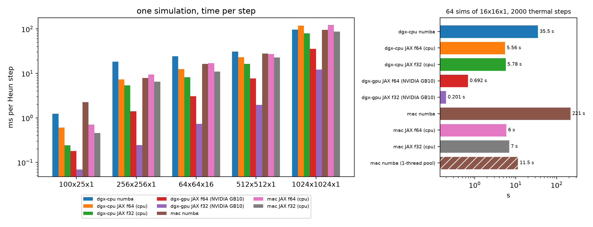
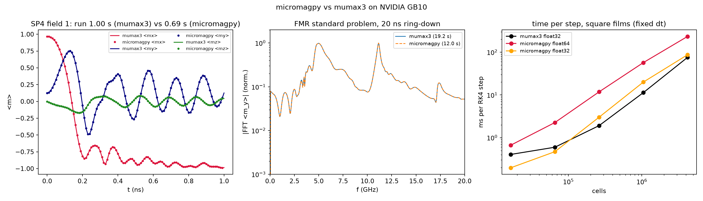

# micromagpy

[](https://pypi.org/project/micromagpy/)
[](https://pypi.org/project/micromagpy/)
[](https://github.com/LemurPwned/micromagpy/actions/workflows/tests.yml)
[](https://github.com/LemurPwned/micromagpy/blob/master/COPYING.LESSER)

A small finite-difference micromagnetic simulator in Python. The time loop
runs as one compiled [JAX](https://github.com/jax-ml/jax) program on the CPU
or GPU (with a vectorised NumPy reference path), the
demagnetising field is an FFT convolution with the Newell tensor, and the
package adds adaptive solvers, energy minimisation, spin-orbit and spin-transfer
torques, and thermal and 1/f noise.

**Origin.** micromagpy grew out of
["70 lines of NumPy"](https://github.com/micromagnetics/70LinesOfNumpy) by
Claas Abert, which solves MuMag standard problem #4 in under 70 lines of
NumPy. The original code is described in
[arXiv:1411.7188](http://arxiv.org/abs/1411.7188).

**License.** LGPL-3.0-or-later, the license of the original code (see
[`LICENSE`](https://github.com/LemurPwned/micromagpy/blob/master/LICENSE),
[`COPYING.LESSER`](https://github.com/LemurPwned/micromagpy/blob/master/COPYING.LESSER)
and [`CREDITS.md`](https://github.com/LemurPwned/micromagpy/blob/master/CREDITS.md)).

## Contents

- [Installation](#installation)
- [Quickstart: standard problem #4](#quickstart-standard-problem-4)
- [Features](#features)
- [Performance](#performance)
- [Curated examples](#curated-examples)
- [Testing](#testing)
- [Releasing](#releasing)

## Installation

micromagpy needs Python 3.13 or newer.

```bash
pip install micromagpy
```

Optional extras:

```bash
pip install "micromagpy[examples]"   # matplotlib, tqdm, pillow for the example scripts
pip install "micromagpy[test]"       # pytest
```

Development install from a clone:

```bash
git clone https://github.com/LemurPwned/micromagpy.git
cd micromagpy
python -m venv .venv && source .venv/bin/activate
pip install -e ".[test,examples]"
pre-commit install                    # optional: formatting and lint hooks
```

For an NVIDIA GPU install `pip install "micromagpy[cuda]"` (JAX with CUDA 13).
The NumPy path's FFTs use `scipy.fft` with all cores; set
`MICROMAGPY_FFT_WORKERS` to limit them.

## Quickstart: standard problem #4

Relax a permalloy strip into the s-state, then switch it with field 1 of
[µMAG standard problem #4](https://www.ctcms.nist.gov/~rdm/std4/spec4.html):

```python
import numpy as np

from micromagpy.config import MU0
from micromagpy.demag import compute_demag_tensor
from micromagpy.energy import relax
from micromagpy.simulation import simulate

n, dx = (100, 25, 1), (5e-9, 5e-9, 3e-9)  # cells, cell size (m)
ms, A = 8e5, 1.3e-11                       # Ms (A/m), exchange stiffness (J/m)

m = np.zeros(n + (3,))                     # starting guess for the s-state
m[1:-1, :, :, 0] = 1.0
m[(-1, 0), :, :, 1] = 1.0

demag = compute_demag_tensor(n, dx)        # computed once, reused by both calls
s_state = relax(m, dx, ms, A=A, demag=demag)["m"]

h1 = np.array([-24.6e-3, 4.3e-3, 0.0]) / MU0  # field 1 of SP4 (mu0 H in T -> A/m)
res = simulate(s_state, dx, ms, A, alpha=0.02, dt=1e-12, steps=1000,
               h_ext=h1, demag=demag, solver="rk45", record_every=10)
print(res["t"][-1], res["m_avg"][-1])      # time (s), average m at the end
```

`simulate` returns a dict with the recorded times `t`, the averages `m_avg`
and the final magnetisation `m`. A full SP4 script with plots is in
[`sp4_simple.py`](https://github.com/LemurPwned/micromagpy/blob/master/sp4_simple.py).

## Features

All fields are in A/m. The magnetisation is an array of shape `n + (3,)`
(`n = (nx, ny, nz)`) holding unit vectors; cells with `|m| = 0` are
non-magnetic and are left out of averages.

### Mesh and shapes

```python
import numpy as np
from micromagpy.shapes import circular_mask, elliptical_mask, init_m, span_grid

n, dx = (32, 32, 1), (4e-9, 4e-9, 2e-9)
m, _ = init_m(n)                       # SP4-like starting state
grid = span_grid(n)                    # index grid of shape (4,) + n + (3,)
disk = circular_mask(16, 16, 15, grid) # boolean mask of shape n + (3,), radius in cells
ellipse = elliptical_mask(16, 16, 15, 8, grid)

m = np.zeros(n + (3,))
m[..., 2] = 1.0
m = np.where(disk, m, 0.0)             # a disk; cells outside it are empty
```

### Demagnetisation

`compute_demag_tensor(n, dx)` builds the Newell tensor (Newell et al.,
J. Geophys. Res. 98, 9551, 1993) and returns it already in Fourier space. The
`f` and `g` functions are evaluated once per node (vectorised NumPy), and
the 64-term sum becomes a separable second difference. The convolution uses
real FFTs (`scipy.fft`, multithreaded). Each axis is padded to a fast size of
at least `2n - 1` (for example 199 becomes 200), and axes with a single cell
are not transformed.

```python
import numpy as np
from micromagpy.demag import compute_demag_tensor, compute_trivial_tensor
from micromagpy.fields import compute_hdemag

n, dx, ms = (32, 8, 1), (5e-9, 5e-9, 3e-9), 8e5
m = np.zeros(n + (3,))
m[..., 0] = 1.0
f_n = compute_demag_tensor(n, dx)      # pass as demag=f_n to simulate/relax/energies
h_d = ms * compute_hdemag(m, f_n, n)   # compute_hdemag returns H_d in units of Ms
no_demag = compute_trivial_tensor(n)   # or demag=False
```

### Exchange, uniaxial anisotropy and Zeeman

Exchange is `2A/(mu0 Ms) ∇²m` with Neumann boundaries. Uniaxial anisotropy
is `2K/(mu0 Ms) (m·u) u`; `K` can be a scalar or an array of shape `n`, and
the axis `kaxis` a vector or an array of shape `n + (3,)`. This allows grains
or domains with their own anisotropy.

```python
import numpy as np
from micromagpy.demag import compute_demag_tensor
from micromagpy.fields import compute_anisotropy_field, compute_hex, h_eff
from micromagpy.noise import voronoi_grains

n, dx, ms, A = (32, 32, 1), (4e-9, 4e-9, 2e-9), 8e5, 1.3e-11
rng = np.random.default_rng(0)
m = rng.normal(size=n + (3,))
m /= np.linalg.norm(m, axis=-1, keepdims=True)

h_ex = compute_hex(A, ms, m, dx)
h_k = compute_anisotropy_field(ms, 5e5, m, (0, 0, 1))

# per-cell anisotropy: 20 Voronoi grains with random easy axes and K
grains = voronoi_grains(n, 20, seed=0)             # labels 1..20, shape n
axes = rng.normal(size=(21, 3))
K = rng.normal(5e5, 5e4, size=21)[grains]          # shape n
kaxis = axes[grains]                               # shape n + (3,)
h = h_eff(A, ms, K, kaxis, m, None, compute_demag_tensor(n, dx), n, dx)  # demag + exchange + anisotropy
```

The Zeeman field goes to `simulate`, `relax` and `energies` as `h_ext`. It can
be a 3-vector, an array of shape `n + (3,)` or, for `simulate`, a callable
`h_ext(t)`:

```python
h_ext = lambda t: np.array([0.0, 0.0, 1e4 * np.sin(2 * np.pi * 5e9 * t)])
```

### Interfacial DMI

`D` (J/m²) switches on the interfacial Dzyaloshinskii-Moriya interaction of a
film with normal z, in `h_eff`, `simulate`, `relax`, `energies` and the JAX
`make_field`. The sign convention is MuMax3's `Dind`. The energy density
`D [m_z ∇·m − (m·∇) m_z]` is discretised on nearest-neighbour bonds:

- Inside the magnet the field is the central difference
  `2D/(mu0 Ms) (∂x m_z, ∂y m_z, −∂x m_x − ∂y m_y)`.
- At mesh edges and next to empty cells, the missing bonds give the free-edge
  condition `∂m/∂n = D/(2A) (z × n) × m`.
- The field is the exact gradient of `energies(...)["dmi"]`.

The edge tilt of a PMA strip converges to Rohart & Thiaville's
`sin θ = D / 2√(AK)` at first order in the cell size (`tests/test_dmi.py`).
Use cells well below the DMI length `2A/D`.

```python
from micromagpy.fields import compute_hdmi

h_dmi = compute_hdmi(D=2e-3, ms=ms, m=m, dx=dx)
res = relax(m, dx, ms, A=A, K=K, D=2e-3)   # or simulate(..., D=2e-3)
```

### Solvers

`simulate(m, dx, ms, A, alpha, dt, steps, ...)` integrates the LLG equation:

| `solver=` | method | field evaluations per step | use for |
| --- | --- | --- | --- |
| `"euler"` | explicit Euler | 1 | quick tests (unstable for low damping and small cells) |
| `"heun"` (default) | stochastic Heun (Stratonovich) | 2 | thermal (white) noise |
| `"rk4"` | classical Runge-Kutta | 4 | deterministic or coloured noise, fixed step |
| `"rk45"` | adaptive Dormand-Prince 5(4), FSAL | ~6 per internal step | deterministic dynamics; `dt` is the output interval, `tol` the per-cell error |

```python
import numpy as np
from micromagpy.simulation import simulate

n, dx = (8, 8, 1), (4e-9, 4e-9, 1e-9)
m = np.zeros(n + (3,))
m[..., 2] = 1.0
res = simulate(m, dx, 8.2e5, 1.3e-11, 0.01, 1e-12, 200, K=4.89e5, kaxis=(0, 0, 1),
               h_ext=(1e4, 0, 7e5), solver="rk45", tol=1e-5,
               callback=lambda i, t, mm: None, record_every=10)
print(res["rk45_steps"], res["rk45_rejected"])
```

The single steps are also available on their own:
`micromagpy.llg.rk4`, `micromagpy.llg.stochastic_heun`, `micromagpy.llg.pure_llg`
(Euler) and `micromagpy.solvers.integrate_rk45` together with `llg_rhs_factory`.

### Energies and relaxation

`energies` returns the exchange, DMI, demag, anisotropy and Zeeman energies (J)
and their sum. `relax` minimises the energy by integrating the
precession-free flow `dm/dt = -gamma m x (m x H)` with adaptive steps, until
`max |m x H| < torque_tol * Ms`.

```python
import numpy as np
from micromagpy.energy import energies, relax

n, dx, ms, A = (40, 10, 1), (5e-9, 5e-9, 3e-9), 8e5, 1.3e-11
m = np.zeros(n + (3,))
m[1:-1, :, :, 0] = 1.0
m[(-1, 0), :, :, 1] = 1.0
r = relax(m, dx, ms, A=A, torque_tol=1e-3, energy_every=10)
print(r["converged"], r["steps"], r["energies"]["total"])
e = energies(r["m"], dx, ms, A=A, h_ext=(1e3, 0, 0))   # dict: exchange, demag, anisotropy, zeeman, total
```

### Thermal field

`ThermalField` is Brown's white thermal field,
`sigma = sqrt(2 alpha kB T / (gamma0 mu0 Ms V dt))` per component. Use it
with the stochastic Heun solver. The temperature can be a callable `T(t)`.

```python
import numpy as np
from micromagpy.noise import ThermalField
from micromagpy.simulation import simulate

n, dx, ms, alpha, dt = (16, 16, 1), (4e-9, 4e-9, 2e-9), 8e5, 0.02, 5e-14
m = np.zeros(n + (3,))
m[..., 2] = 1.0
thermal = ThermalField(n, dx, ms, alpha, temperature=300.0, dt=dt, seed=1)
res = simulate(m, dx, ms, 1.3e-11, alpha, dt, 200, K=6e5, noise=[thermal], solver="heun")
```

### 1/f noise generators

`micromagpy.noise` ports the generators of
[cmtj](https://github.com/LemurPwned/cmtj) and adds a streaming one suited to
meshes. Every generator takes a `shape` for many independent channels and a
`seed` (an int or a `np.random.Generator`).

| generator | what it is |
| --- | --- |
| `alpha_noise`, `BufferedAlphaNoise` | Kasdin's fractional-integration filter, PSD ~ 1/f^alpha (cmtj `BufferedAlphaNoise`). Each buffer is independent. |
| `VectorAlphaNoise` | three buffered components, normalised like cmtj |
| `OneFNoise` | cmtj's geometric-trial pink noise |
| `OUAlphaNoise` | 1/f^alpha from a sum of Ornstein-Uhlenbeck processes with log-spaced corner frequencies (0 < alpha < 2). It is exact for any `dt`, streams without buffers and needs O(poles) memory per channel. |

```python
from micromagpy.noise import (BufferedAlphaNoise, OneFNoise, OUAlphaNoise,
                              VectorAlphaNoise, alpha_noise)

x = alpha_noise(4096, Qstd=1.0, alpha=1.0, seed=0)                  # 4096 samples
buf = BufferedAlphaNoise(buffer_size=1024, alpha=1.0, std=1.0, shape=(4,), seed=0)
vec = VectorAlphaNoise(buffer_size=1024, alpha=1.0, std=1.0, scale=1e3, axis="all", seed=0)
onef = OneFNoise(sources=16, bias=0.5, scale=1.0, seed=0)
ou = OUAlphaNoise(alpha=1.0, std=1.0, f_min=1e6, f_max=1e11, dt=1e-12, shape=(8, 8), seed=0)
samples = buf.tick(), vec.tick_vector(), onef.tick(), ou.tick()     # one step each
```

### Noise fields on the mesh

- `ColouredNoiseField`: a 1/f^alpha field. It can be one noise vector per
  region (integer labels, a list of masks or `voronoi_grains`, with optional
  Hooge-like `1/sqrt(volume)` amplitude scaling), or one per cell with an
  optional Gaussian `correlation_length`. An optional fixed `axis` makes it a
  scalar process along that axis. The temporal generator is `"ou"` (default)
  or `"buffered"`.
- `AnisotropyNoise`: 1/f^alpha fluctuations `K -> K + dK(r, t)` of the
  uniaxial anisotropy. Its field depends on `m` and is re-evaluated at every
  solver stage.

```python
import numpy as np
from micromagpy.noise import (AnisotropyNoise, ColouredNoiseField, ThermalField,
                              voronoi_grains)
from micromagpy.simulation import simulate

n, dx, ms, alpha, dt = (32, 32, 1), (4e-9, 4e-9, 2e-9), 8e5, 0.02, 5e-14
m = np.zeros(n + (3,))
m[..., 2] = 1.0
grains = voronoi_grains(n, 30, seed=0)
noise = [
    ColouredNoiseField(n, 2e3, alpha=1.0, dt=dt, regions=grains, volume_scaling=True, seed=1),
    ColouredNoiseField(n, 5e2, alpha=1.0, dt=dt, correlation_length=10e-9, dx=dx, seed=2),
    AnisotropyNoise(n, ms, dK_std=1e4, kaxis=(0, 0, 1), alpha=1.0, dt=dt, regions=grains, seed=3),
    ThermalField(n, dx, ms, alpha, 300.0, dt, seed=4),
]
res = simulate(m, dx, ms, 1.3e-11, alpha, dt, 100, K=6e5, noise=noise)  # stochastic Heun
```

### Time drivers and constants

Time-dependent quantities come from drivers in `micromagpy.drivers`, which mirror
cmtj's scalar and axial drivers: `constant`, `step`, `pulse` and `sine`. Any value
accepted as an amplitude can be a number, an array, a `callable(t)` or a driver;
`as_driver` converts it once at construction. This covers `simulate(h_ext=...)`,
`SOT`/`STT` amplitudes and polarisation, and the `ThermalField` temperature.
Physical constants (`MU0`, `GAMMA`, `HBAR`, `ELECTRON_CHARGE`, `BOLTZMANN`) live
in `micromagpy.config`.

```python
from micromagpy import drivers

h_ext = drivers.sine((0, 0, 5e3), frequency=10e9, offset=(0, 0, 4e5))   # A/m
hdl = drivers.pulse(2e4, start=0.0, width=0.5e-9)                         # 0.5 ns SOT pulse
temperature = drivers.step(300.0, start=1e-9)                             # heat up at 1 ns
print(h_ext(0.0), float(hdl(0.2e-9)), float(temperature(0.5e-9)))
```

### Spin-orbit and spin-transfer torques

These follow [cmtj](https://github.com/LemurPwned/cmtj)'s conventions. With
`gamma' = gamma0 / (1 + alpha^2)`:

`dm/dt = -gamma' [ m x H + alpha m x (m x H) + a_fl m x p + a_dl m x (m x p) ]`

- `SOT(Hfl, Hdl, p)` (cmtj `createSOTLayer`): field-like and damping-like
  amplitudes in A/m, with `a_fl = Hfl - alpha Hdl` and `a_dl = Hdl + alpha Hfl`.
- `STT(j, p, thickness, ms, polarisation, spacer_lambda, beta, kappa, alternative)`
  (cmtj `createSTTLayer`, Slonczewski): `aJ = hbar j / (e mu0 Ms d)`,
  `eta = P L^2 / (L^2 + 1 + (L^2 - 1) m·p)`, or `P / (1 + L m·p)` with
  `alternative=True`.

Amplitudes can be scalars, per-cell arrays, callables of time or drivers. `p` can
be a vector or a per-cell array. `mask` limits the torque to part of the mesh.

```python
import numpy as np
from micromagpy import drivers
from micromagpy.simulation import simulate
from micromagpy.torques import SOT, STT

n, dx, ms, alpha = (16, 16, 1), (4e-9, 4e-9, 1e-9), 8e5, 0.05
m = np.zeros(n + (3,))
m[..., 2] = 1.0
sot = SOT(Hfl=0.0, Hdl=drivers.pulse(2e4, start=0.0, width=0.5e-9), p=(0, 1, 0))  # A/m
stt = STT(j=-5e10, p=(0, 0, 1), thickness=1e-9, ms=ms, polarisation=0.6, spacer_lambda=1.0)
res = simulate(m, dx, ms, 1.3e-11, alpha, 1e-12, 100, K=8e5, h_ext=(2e4, 0, 0),
               torques=[sot, stt], solver="rk45")
```

### Multilayers and interlayer exchange coupling

```python
import jax.numpy as jnp
from micromagpy.stack import Ellipse, Layer, Spacer, Stack

pillar = Ellipse(64e-9, 64e-9)                       # or Bar(lx, ly); centred, lengths in m
saf = Stack([Layer(pillar, 1.0e-9, ms=8e5, A=1.5e-11, K=9e5),
             Spacer(0.8e-9, J1=-1e-3, J2=0.0),         # IEC, J/m^2 (cmtj convention)
             Layer(pillar, 1.2e-9, ms=9e5, A=1.5e-11, K=8e5)], cell=(4e-9, 4e-9))
m = saf.relax(saf.uniform([(0, 0, 1), (0, 0, -1)]), h_ext=(0, 0, 5e4))["m"]   # (layers, nx, ny, 3)
out = saf.run(m, dt=1e-12, steps=5000, h_ext=lambda t: jnp.array([1e4, 0, 5e4]), solver="rk45")
out["m_avg"]                                          # (records, layers, 3)
```

Each layer is one cell thick, and all layers share the x/y grid. The demag
includes every layer's field on every other layer: Newell tensors for boxes of
different thickness at the real gaps, with one FFT per layer and step. IEC
couples the layers on either side of a spacer, cell by cell:
H = (J1 + 2 J2 m·m′) m′ / (μ0 Ms t). The constructor precomputes everything,
and J1, J2, fields, torques and temperature are arguments, so sweeps `jit` and
`vmap` without recompiling. Damping, thermal field and SOT amplitudes can
differ per layer. `Stack(..., interlayer_demag=False)` drops the interlayer
dipolar field, as macrospin codes such as cmtj do.

### Analysis helpers

```python
import numpy as np
from micromagpy.noise import OUAlphaNoise, fit_spectral_exponent, power_spectral_density

dt = 1e-12
gen = OUAlphaNoise(alpha=1.0, std=1.0, f_min=1e6, f_max=1e11, dt=dt, seed=0)
x = np.array([gen.tick() for _ in range(2**15)])
f, psd = power_spectral_density(x, dt, segments=8)               # one-sided Welch PSD
print(fit_spectral_exponent(f, psd, f_min=1e8, f_max=1e10))      # about 1, +/- 0.1 between seeds
print(fit_spectral_exponent(f, gen.theoretical_psd(f), f_min=1e8, f_max=1e10))  # 1.01, exact spectrum
```

## Performance

micromagpy has two paths with the same discretisation:

- **JAX** ([`micromagpy/jax_backend.py`](https://github.com/LemurPwned/micromagpy/blob/master/micromagpy/jax_backend.py)):
  the effective field, the LLG right-hand side and the solver are traced once
  and run as one compiled loop on the CPU or GPU, and independent runs batch
  with `jax.vmap`. Use it for anything long or swept.
- **NumPy reference** (`simulate`, `energy.relax`, `fields.*`): vectorised
  NumPy with real FFTs (`scipy.fft`), one Python iteration per step. It takes
  arbitrary Python `h_ext` callables, callbacks and stateful noise objects, and
  needs no compilation (the standard problem #4 quickstart runs in 4.7 s on an
  M5 Pro).

The reference path used to be fused numba kernels. Against them, JAX on the
CPU is 3x faster for small meshes and up to 20 % slower for large ones, and on
the GPU it is faster everywhere; one backend is easier to keep correct, so
numba was removed. The numba numbers below are kept for comparison. The demag tensor is computed once per mesh: the 64-term
Newell sum becomes `f`/`g` evaluated once per node (vectorised NumPy) and a
separable second difference (0.1 s for 64x64x16; the original pure-Python code
took 26 s for 100x25x1).

From [`benchmarks/benchmark.py`](https://github.com/LemurPwned/micromagpy/blob/master/benchmarks/benchmark.py):
one step is `h_eff` (demag, exchange) plus one Euler LLG update. JAX steps are
timed inside a `lax.scan`, as `jax_backend.run` integrates. Results are in
`benchmarks/figures/benchmark_mac.json` (Apple M5 Pro, 18 cores) and
`benchmark_dgx.json` (NVIDIA DGX Spark, GB10 GPU):

| mesh | original NumPy | numba (removed) | JAX f64, M5 Pro CPU | JAX f64, GB10 | JAX f32, GB10 | demag tensor, original | demag tensor, numba |
| --- | --- | --- | --- | --- | --- | --- | --- |
| 100x25x1 | 1.14 ms | 0.48 ms (2x) | 0.166 ms (7x) | 0.092 ms (12x) | 0.039 ms (29x) | 11.5 s | 2 ms |
| 256x256x1 | 37.21 ms | 1.33 ms (28x) | 1.525 ms (24x) | 0.732 ms (51x) | 0.123 ms (303x) | not run | 24 ms |
| 64x64x16 | 87.48 ms | 2.33 ms (38x) | 2.774 ms (32x) | 1.511 ms (58x) | 0.35 ms (250x) | not run | 25 ms |

Times per step on the M5 Pro unless marked GB10; speed-ups are relative to the original NumPy on the M5 Pro. Demag tensor times on the M5 Pro; the vectorised NumPy version that replaced numba takes 6 ms for 100x25x1 and 0.1 s for 64x64x16.


### JAX backend (GPU, batched sweeps)

[`micromagpy/jax_backend.py`](https://github.com/LemurPwned/micromagpy/blob/master/micromagpy/jax_backend.py)
(`pip install "micromagpy[cuda]"` for an NVIDIA GPU) runs the same
discretisation as the NumPy path, as one compiled loop, and batches
independent runs with `jax.vmap`:

- **Fields:** Newell demag, Neumann exchange, uniaxial anisotropy and interfacial DMI.
- **Torques:** SOT (`sot`) and STT (`stt`).
- **Noise:** the thermal field (`sigma`) and coloured 1/f field noise
  (`coloured_noise(ColouredNoiseField(...))`, OU generator), drawn from the
  run's PRNG key inside the compiled loop.
- **Solvers:** `run` integrates with Heun, RK4 or adaptive Dormand-Prince (`solver="rk45"`). `relax` is the energy minimiser.

`relax` and `run` can be jitted, vmapped and put inside a `lax.scan`, so a whole
hysteresis or FMR field sweep compiles into one call. `tests/test_jax.py` checks
them against `simulate` and `energy.relax`. Fields and the Heun/RK4 trajectories
agree to 1e-10, and the RK45 and relax results agree to 1e-9 with the same
number of accepted steps.

```python
# hysteresis sweep: relax at every field, starting from the previous state
field = mj.make_field(n, dx, ms, A, K=Ku, kaxis=(1, 0, 0))
point = lambda m, h: (lambda r: (r["m"], r["m"][..., 0].mean()))(
    mj.relax(m, field, ms, h_ext=jnp.array([h, 0, 0]), torque_tol=1e-4, tol=1e-6))
mx = jax.jit(lambda m0, H: jax.lax.scan(point, m0, H)[1])(m0, H_values)
```

```python
import jax, jax.numpy as jnp
from micromagpy import jax_backend as mj

field = mj.make_field(n, dx, ms, A, K=Ku, kaxis=(0, 0, 1), dtype=jnp.float32)
sigma = mj.thermal_sigma(dx, ms, alpha, 300.0, dt)
sweep = jax.jit(jax.vmap(lambda H, key: mj.run(
    m0, field, alpha, dt, 20_000, h_ext=lambda t: jnp.array([0, 0, 1.0]) * H, sigma=sigma, key=key)["m_avg"]))
m_avg = sweep(H_values, jax.random.split(jax.random.PRNGKey(0), len(H_values)))
```

From [`benchmarks/benchmark_jax.py`](https://github.com/LemurPwned/micromagpy/blob/master/benchmarks/benchmark_jax.py)
(time per Heun step of one simulation, and 64 thermal runs of a 16x16x1 mesh,
2000 steps each, e.g. a field sweep; measured against the former numba path).
Machines: Apple M5 Pro (18 cores), NVIDIA DGX Spark (GB10 GPU, 20-core Grace CPU):

| mesh | numba, M5 Pro | numba, Grace | JAX f64, GB10 | JAX f32, GB10 |
| --- | --- | --- | --- | --- |
| 100x25x1 | 2.25 ms | 1.24 ms | 0.18 ms | 0.069 ms |
| 256x256x1 | 7.9 ms | 18.4 ms | 1.41 ms | 0.24 ms |
| 64x64x16 | 16.3 ms | 24.3 ms | 3.06 ms | 0.73 ms |
| 512x512x1 | 27.9 ms | 30.9 ms | 7.6 ms | 1.97 ms |
| 1024x1024x1 | 95.6 ms | 96.3 ms | 35.6 ms | 12.2 ms |
| 64 x 16x16x1 thermal runs | 221 s (11.5 s in a 1-thread process pool) | 35.5 s | 0.69 s | 0.20 s |

On a CPU the JAX backend ranged from 1.3x slower (1024x1024, float64) to 3x
faster (small meshes, no per-step Python overhead) than numba for one
simulation, and 6-40x faster for batches of small meshes.
On the GPU, float32 is 3-6x faster than float64 (the GB10 has little FP64
throughput).



### vs mumax3

[`benchmarks/mumax_compare.py`](https://github.com/LemurPwned/micromagpy/blob/master/benchmarks/mumax_compare.py)
runs both codes on the same GB10; mumax3 3.12 runs from
[`benchmarks/mumax3/Dockerfile`](https://github.com/LemurPwned/micromagpy/blob/master/benchmarks/mumax3/Dockerfile)
(CUDA 13, amd64/arm64). Times are the simulation only: no demag tensor, no
compile (micromagpy) and no kernel setup (mumax3). Both use Dormand-Prince
with error 1e-5 per step on SP4 and FMR.

| problem | mumax3 (f32) | micromagpy f64 | micromagpy f32 |
| --- | --- | --- | --- |
| SP4, 128x32x1: relax | 1.48 s | 0.67 s | |
| SP4: 1 ns, field 1 | 1.00 s | 0.69 s | |
| FMR standard problem, 24x24x2: 20 ns | 19.2 s | 12.0 s | |
| RK4 step, 128x128x1 | 0.40 ms | 0.67 ms | 0.20 ms |
| RK4 step, 512x512x1 | 1.9 ms | 11.8 ms | 3.0 ms |
| RK4 step, 1024x1024x1 | 11.3 ms | 57 ms | 20 ms |
| RK4 step, 2048x2048x1 | 76 ms | 235 ms | 87 ms |

The SP4 traces agree to 0.006 in <m> and the FMR spectra peak in the same
0.05 GHz bins. Large meshes are bound by memory traffic of the FFT
convolution, where mumax3's in-place cuFFT and fused kernel multiply make
fewer passes than XLA's out-of-place FFTs and transposes.



## Curated examples

[`examples/curated/`](https://github.com/LemurPwned/micromagpy/tree/master/examples/curated)
holds micromagnetic versions of the
[cmtj curated examples](https://github.com/LemurPwned/cmtj/tree/master/curated-examples),
in topic folders with their figures, one page per example and run times in
each folder's `results/`:

* `noise/`: 1/f generator spectra, seeded reproducible noise, thermal noise of
  PMA / IMA domains with dispersed anisotropy (animated), noise spectrograms;
* `dynamics/`: FMR field scan, spin-torque oscillator, IEC-coupled
  oscillations of two layers, IEC synchronising two PMA layers with
  different Ku;
* `switching/`: field hysteresis, SOT switching loops, SOT switching phase
  diagram at 300 K, a p-bit (the last two batched with JAX), Co/Ru/Co SAF
  loops and Co/Pt/Co out-of-plane loops (multilayer `Stack` with IEC);
* `transport/`: Rxx / Rxy magnetoresistance sweeps and spin-diode
  (mixing voltage) field scans (JAX).

The scripts need the `examples` extra (`pip install "micromagpy[examples]"`).

## Testing

```bash
pip install -e ".[test]"
python -m pytest -q tests
```

The tests check the kernels (demag tensor and field, exchange, LLG) against
the original NumPy reference implementation (`tests/_reference.py`). They also
cover scale invariance of the demag tensor, the solvers (analytic precession,
RK45, relaxation, stability), the noise spectra and statistics (including
thermal equilibrium against the Langevin function), and the SOT/STT formulas
against cmtj's.
CI runs the suite on Python 3.13 and 3.14
([`.github/workflows/tests.yml`](https://github.com/LemurPwned/micromagpy/blob/master/.github/workflows/tests.yml)).

## Releasing

Version numbers are never edited by hand. The version comes from the latest git tag
(`vX.Y.Z`) through [hatch-vcs](https://github.com/ofek/hatch-vcs). An untagged commit
builds as a development version (`X.Y.Z+1.devN`), and the installed package reports
it as `micromagpy.__version__`. Releases go to PyPI from
[`.github/workflows/release.yml`](https://github.com/LemurPwned/micromagpy/blob/master/.github/workflows/release.yml)
through [Trusted Publishing](https://docs.pypi.org/trusted-publishers/)
(OIDC), so no API tokens are stored.

To cut a release:

1. Merge to `master`.
2. Go to *Actions → release → Run workflow* on `master` and pick the bump:
   `patch` (0.2.0 → 0.2.1), `minor` (0.2.1 → 0.3.0) or `major` (0.3.0 → 1.0.0).
   Before the first tag the base version is 0.1.0, so the first `minor` release is 0.2.0.
3. The workflow then:
   - computes the next version from the latest tag;
   - creates the tag and a GitHub release with generated notes;
   - builds the sdist and wheel and runs `twine check`;
   - checks that the built version matches the tag;
   - publishes to PyPI from the `pypi` environment.

Other ways to run it:

- **Hand-made release:** publishing a GitHub release yourself (tag `vX.Y.Z`) publishes that version.
- **Tag only:** pushing a `v*` tag without a release just builds and checks.
- **TestPyPI:** `bump = testpypi-dev` publishes a development version of the current commit to TestPyPI only, without creating a tag.

To build and check locally:

```bash
pip install build twine
python -m build
twine check dist/*
```

One-time setup:

1. On PyPI, open *Your account → Publishing → Add a new pending publisher*
   (or *Manage project → Publishing* once the project exists) and enter:
   PyPI project name `micromagpy`, owner `LemurPwned`, repository `micromagpy`,
   workflow `release.yml`, environment `pypi`.
2. Optionally do the same on [TestPyPI](https://test.pypi.org/) with
   environment `testpypi`.
3. On GitHub, under *Settings → Environments*, create the `pypi` (and
   `testpypi`) environment. Adding required reviewers or a tag rule (`v*`)
   there is a good extra safeguard.
