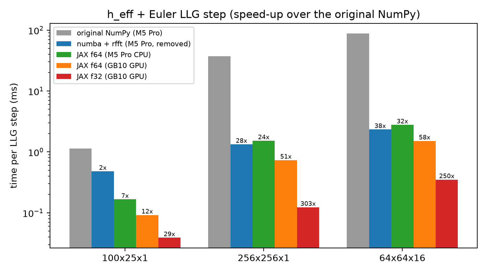

# micromagpy

[](https://pypi.org/project/micromagpy/)
[](https://pypi.org/project/micromagpy/)
[](https://github.com/LemurPwned/micromagpy/actions/workflows/tests.yml)
[](https://github.com/LemurPwned/micromagpy/blob/master/COPYING.LESSER)

A small finite-difference micromagnetic simulator in Python. Effective fields
and LLG updates are fused [numba](https://numba.pydata.org/) kernels, the
demagnetising field is an FFT convolution with the Newell tensor, and the
package adds adaptive solvers, energy minimisation, spin-orbit and spin-transfer
torques, and thermal and 1/f noise.

**Origin.** micromagpy grew out of
["70 lines of NumPy"](https://github.com/micromagnetics/70LinesOfNumpy) by
Claas Abert, which solves MuMag standard problem #4 in under 70 lines of
NumPy. The original code is described in
[arXiv:1411.7188](http://arxiv.org/abs/1411.7188).

**License.** LGPL-3.0-or-later, the license of the original code (see
[`LICENSE`](https://github.com/LemurPwned/micromagpy/blob/master/LICENSE),
[`COPYING.LESSER`](https://github.com/LemurPwned/micromagpy/blob/master/COPYING.LESSER)
and [`CREDITS.md`](https://github.com/LemurPwned/micromagpy/blob/master/CREDITS.md)).

## Contents

- [Installation](#installation)
- [Quickstart: standard problem #4](#quickstart-standard-problem-4)
- [Features](#features)
- [Performance](#performance)
- [Curated examples](#curated-examples)
- [Testing](#testing)
- [Releasing](#releasing)

## Installation

micromagpy needs Python 3.13 or newer.

```bash
pip install micromagpy
```

Optional extras:

```bash
pip install "micromagpy[examples]"   # matplotlib, tqdm, pillow for the example scripts
pip install "micromagpy[test]"       # pytest
```

Development install from a clone:

```bash
git clone https://github.com/LemurPwned/micromagpy.git
cd micromagpy
python -m venv .venv && source .venv/bin/activate
pip install -e ".[test,examples]"
pre-commit install                    # optional: formatting and lint hooks
```

The first call of each numba kernel compiles it. Compiled kernels are cached
on disk (`cache=True`), so later runs start quickly. The FFTs use
`scipy.fft` with all cores; set `MICROMAGPY_FFT_WORKERS` to limit them and
`NUMBA_NUM_THREADS` to limit the numba kernels.

## Quickstart: standard problem #4

Relax a permalloy strip into the s-state, then switch it with field 1 of
[µMAG standard problem #4](https://www.ctcms.nist.gov/~rdm/std4/spec4.html):

```python
import numpy as np

from micromagpy.config import MU0
from micromagpy.demag import compute_demag_tensor
from micromagpy.energy import relax
from micromagpy.simulation import simulate

n, dx = (100, 25, 1), (5e-9, 5e-9, 3e-9)  # cells, cell size (m)
ms, A = 8e5, 1.3e-11                       # Ms (A/m), exchange stiffness (J/m)

m = np.zeros(n + (3,))                     # starting guess for the s-state
m[1:-1, :, :, 0] = 1.0
m[(-1, 0), :, :, 1] = 1.0

demag = compute_demag_tensor(n, dx)        # computed once, reused by both calls
s_state = relax(m, dx, ms, A=A, demag=demag)["m"]

h1 = np.array([-24.6e-3, 4.3e-3, 0.0]) / MU0  # field 1 of SP4 (mu0 H in T -> A/m)
res = simulate(s_state, dx, ms, A, alpha=0.02, dt=1e-12, steps=1000,
               h_ext=h1, demag=demag, solver="rk45", record_every=10)
print(res["t"][-1], res["m_avg"][-1])      # time (s), average m at the end
```

`simulate` returns a dict with the recorded times `t`, the averages `m_avg`
and the final magnetisation `m`. A full SP4 script with plots is in
[`sp4_simple.py`](https://github.com/LemurPwned/micromagpy/blob/master/sp4_simple.py).

## Features

All fields are in A/m. The magnetisation is an array of shape `n + (3,)`
(`n = (nx, ny, nz)`) holding unit vectors; cells with `|m| = 0` are
non-magnetic and are left out of averages.

### Mesh and shapes

```python
import numpy as np
from micromagpy.shapes import circular_mask, elliptical_mask, init_m, span_grid

n, dx = (32, 32, 1), (4e-9, 4e-9, 2e-9)
m, _ = init_m(n)                       # SP4-like starting state
grid = span_grid(n)                    # index grid of shape (4,) + n + (3,)
disk = circular_mask(16, 16, 15, grid) # boolean mask of shape n + (3,), radius in cells
ellipse = elliptical_mask(16, 16, 15, 8, grid)

m = np.zeros(n + (3,))
m[..., 2] = 1.0
m = np.where(disk, m, 0.0)             # a disk; cells outside it are empty
```

### Demagnetisation

`compute_demag_tensor(n, dx)` builds the Newell tensor (Newell et al.,
J. Geophys. Res. 98, 9551, 1993) and returns it already in Fourier space. The
`f` and `g` functions are evaluated once per node by numba, in parallel, and
the 64-term sum becomes a separable second difference. The convolution uses
real FFTs (`scipy.fft`, multithreaded). Each axis is padded to a fast size of
at least `2n - 1` (for example 199 becomes 200), and axes with a single cell
are not transformed.

```python
import numpy as np
from micromagpy.demag import compute_demag_tensor, compute_trivial_tensor
from micromagpy.fields import compute_hdemag

n, dx, ms = (32, 8, 1), (5e-9, 5e-9, 3e-9), 8e5
m = np.zeros(n + (3,))
m[..., 0] = 1.0
f_n = compute_demag_tensor(n, dx)      # pass as demag=f_n to simulate/relax/energies
h_d = ms * compute_hdemag(m, f_n, n)   # compute_hdemag returns H_d in units of Ms
no_demag = compute_trivial_tensor(n)   # or demag=False
```

### Exchange, uniaxial anisotropy and Zeeman

Exchange is `2A/(mu0 Ms) ∇²m` with Neumann boundaries. Uniaxial anisotropy
is `2K/(mu0 Ms) (m·u) u`; `K` can be a scalar or an array of shape `n`, and
the axis `kaxis` a vector or an array of shape `n + (3,)`. This allows grains
or domains with their own anisotropy.

```python
import numpy as np
from micromagpy.demag import compute_demag_tensor
from micromagpy.fields import compute_anisotropy_field, compute_hex, h_eff
from micromagpy.noise import voronoi_grains

n, dx, ms, A = (32, 32, 1), (4e-9, 4e-9, 2e-9), 8e5, 1.3e-11
rng = np.random.default_rng(0)
m = rng.normal(size=n + (3,))
m /= np.linalg.norm(m, axis=-1, keepdims=True)

h_ex = compute_hex(A, ms, m, dx)
h_k = compute_anisotropy_field(ms, 5e5, m, (0, 0, 1))

# per-cell anisotropy: 20 Voronoi grains with random easy axes and K
grains = voronoi_grains(n, 20, seed=0)             # labels 1..20, shape n
axes = rng.normal(size=(21, 3))
K = rng.normal(5e5, 5e4, size=21)[grains]          # shape n
kaxis = axes[grains]                               # shape n + (3,)
h = h_eff(A, ms, K, kaxis, m, None, compute_demag_tensor(n, dx), n, dx)  # demag + exchange + anisotropy
```

The Zeeman field goes to `simulate`, `relax` and `energies` as `h_ext`. It can
be a 3-vector, an array of shape `n + (3,)` or, for `simulate`, a callable
`h_ext(t)`:

```python
h_ext = lambda t: np.array([0.0, 0.0, 1e4 * np.sin(2 * np.pi * 5e9 * t)])
```

### Solvers

`simulate(m, dx, ms, A, alpha, dt, steps, ...)` integrates the LLG equation:

| `solver=` | method | field evaluations per step | use for |
| --- | --- | --- | --- |
| `"euler"` | explicit Euler | 1 | quick tests (unstable for low damping and small cells) |
| `"heun"` (default) | stochastic Heun (Stratonovich) | 2 | thermal (white) noise |
| `"rk4"` | classical Runge-Kutta | 4 | deterministic or coloured noise, fixed step |
| `"rk45"` | adaptive Dormand-Prince 5(4), FSAL | ~6 per internal step | deterministic dynamics; `dt` is the output interval, `tol` the per-cell error |

```python
import numpy as np
from micromagpy.simulation import simulate

n, dx = (8, 8, 1), (4e-9, 4e-9, 1e-9)
m = np.zeros(n + (3,))
m[..., 2] = 1.0
res = simulate(m, dx, 8.2e5, 1.3e-11, 0.01, 1e-12, 200, K=4.89e5, kaxis=(0, 0, 1),
               h_ext=(1e4, 0, 7e5), solver="rk45", tol=1e-5,
               callback=lambda i, t, mm: None, record_every=10)
print(res["rk45_steps"], res["rk45_rejected"])
```

The single steps are also available on their own:
`micromagpy.llg.rk4`, `micromagpy.llg.stochastic_heun`, `micromagpy.llg.pure_llg`
(Euler) and `micromagpy.solvers.integrate_rk45` together with `llg_rhs_factory`.

### Energies and relaxation

`energies` returns the exchange, demag, anisotropy and Zeeman energies (J)
and their sum. `relax` minimises the energy by integrating the
precession-free flow `dm/dt = -gamma m x (m x H)` with adaptive steps, until
`max |m x H| < torque_tol * Ms`.

```python
import numpy as np
from micromagpy.energy import energies, relax

n, dx, ms, A = (40, 10, 1), (5e-9, 5e-9, 3e-9), 8e5, 1.3e-11
m = np.zeros(n + (3,))
m[1:-1, :, :, 0] = 1.0
m[(-1, 0), :, :, 1] = 1.0
r = relax(m, dx, ms, A=A, torque_tol=1e-3, energy_every=10)
print(r["converged"], r["steps"], r["energies"]["total"])
e = energies(r["m"], dx, ms, A=A, h_ext=(1e3, 0, 0))   # dict: exchange, demag, anisotropy, zeeman, total
```

### Thermal field

`ThermalField` is Brown's white thermal field,
`sigma = sqrt(2 alpha kB T / (gamma0 mu0 Ms V dt))` per component. Use it
with the stochastic Heun solver. The temperature can be a callable `T(t)`.

```python
import numpy as np
from micromagpy.noise import ThermalField
from micromagpy.simulation import simulate

n, dx, ms, alpha, dt = (16, 16, 1), (4e-9, 4e-9, 2e-9), 8e5, 0.02, 5e-14
m = np.zeros(n + (3,))
m[..., 2] = 1.0
thermal = ThermalField(n, dx, ms, alpha, temperature=300.0, dt=dt, seed=1)
res = simulate(m, dx, ms, 1.3e-11, alpha, dt, 200, K=6e5, noise=[thermal], solver="heun")
```

### 1/f noise generators

`micromagpy.noise` ports the generators of
[cmtj](https://github.com/LemurPwned/cmtj) and adds a streaming one suited to
meshes. Every generator takes a `shape` for many independent channels and a
`seed` (an int or a `np.random.Generator`).

| generator | what it is |
| --- | --- |
| `alpha_noise`, `BufferedAlphaNoise` | Kasdin's fractional-integration filter, PSD ~ 1/f^alpha (cmtj `BufferedAlphaNoise`). Each buffer is independent. |
| `VectorAlphaNoise` | three buffered components, normalised like cmtj |
| `OneFNoise` | cmtj's geometric-trial pink noise |
| `OUAlphaNoise` | 1/f^alpha from a sum of Ornstein-Uhlenbeck processes with log-spaced corner frequencies (0 < alpha < 2). It is exact for any `dt`, streams without buffers and needs O(poles) memory per channel. |

```python
from micromagpy.noise import (BufferedAlphaNoise, OneFNoise, OUAlphaNoise,
                              VectorAlphaNoise, alpha_noise)

x = alpha_noise(4096, Qstd=1.0, alpha=1.0, seed=0)                  # 4096 samples
buf = BufferedAlphaNoise(buffer_size=1024, alpha=1.0, std=1.0, shape=(4,), seed=0)
vec = VectorAlphaNoise(buffer_size=1024, alpha=1.0, std=1.0, scale=1e3, axis="all", seed=0)
onef = OneFNoise(sources=16, bias=0.5, scale=1.0, seed=0)
ou = OUAlphaNoise(alpha=1.0, std=1.0, f_min=1e6, f_max=1e11, dt=1e-12, shape=(8, 8), seed=0)
samples = buf.tick(), vec.tick_vector(), onef.tick(), ou.tick()     # one step each
```

### Noise fields on the mesh

- `ColouredNoiseField`: a 1/f^alpha field. It can be one noise vector per
  region (integer labels, a list of masks or `voronoi_grains`, with optional
  Hooge-like `1/sqrt(volume)` amplitude scaling), or one per cell with an
  optional Gaussian `correlation_length`. An optional fixed `axis` makes it a
  scalar process along that axis. The temporal generator is `"ou"` (default)
  or `"buffered"`.
- `AnisotropyNoise`: 1/f^alpha fluctuations `K -> K + dK(r, t)` of the
  uniaxial anisotropy. Its field depends on `m` and is re-evaluated at every
  solver stage.

```python
import numpy as np
from micromagpy.noise import (AnisotropyNoise, ColouredNoiseField, ThermalField,
                              voronoi_grains)
from micromagpy.simulation import simulate

n, dx, ms, alpha, dt = (32, 32, 1), (4e-9, 4e-9, 2e-9), 8e5, 0.02, 5e-14
m = np.zeros(n + (3,))
m[..., 2] = 1.0
grains = voronoi_grains(n, 30, seed=0)
noise = [
    ColouredNoiseField(n, 2e3, alpha=1.0, dt=dt, regions=grains, volume_scaling=True, seed=1),
    ColouredNoiseField(n, 5e2, alpha=1.0, dt=dt, correlation_length=10e-9, dx=dx, seed=2),
    AnisotropyNoise(n, ms, dK_std=1e4, kaxis=(0, 0, 1), alpha=1.0, dt=dt, regions=grains, seed=3),
    ThermalField(n, dx, ms, alpha, 300.0, dt, seed=4),
]
res = simulate(m, dx, ms, 1.3e-11, alpha, dt, 100, K=6e5, noise=noise)  # stochastic Heun
```

### Time drivers and constants

Time-dependent quantities come from drivers in `micromagpy.drivers`, which mirror
cmtj's scalar and axial drivers: `constant`, `step`, `pulse` and `sine`. Any value
accepted as an amplitude can be a number, an array, a `callable(t)` or a driver;
`as_driver` converts it once at construction. This covers `simulate(h_ext=...)`,
`SOT`/`STT` amplitudes and polarisation, and the `ThermalField` temperature.
Physical constants (`MU0`, `GAMMA`, `HBAR`, `ELECTRON_CHARGE`, `BOLTZMANN`) live
in `micromagpy.config`.

```python
from micromagpy import drivers

h_ext = drivers.sine((0, 0, 5e3), frequency=10e9, offset=(0, 0, 4e5))   # A/m
hdl = drivers.pulse(2e4, start=0.0, width=0.5e-9)                         # 0.5 ns SOT pulse
temperature = drivers.step(300.0, start=1e-9)                             # heat up at 1 ns
print(h_ext(0.0), float(hdl(0.2e-9)), float(temperature(0.5e-9)))
```

### Spin-orbit and spin-transfer torques

These follow [cmtj](https://github.com/LemurPwned/cmtj)'s conventions. With
`gamma' = gamma0 / (1 + alpha^2)`:

`dm/dt = -gamma' [ m x H + alpha m x (m x H) + a_fl m x p + a_dl m x (m x p) ]`

- `SOT(Hfl, Hdl, p)` (cmtj `createSOTLayer`): field-like and damping-like
  amplitudes in A/m, with `a_fl = Hfl - alpha Hdl` and `a_dl = Hdl + alpha Hfl`.
- `STT(j, p, thickness, ms, polarisation, spacer_lambda, beta, kappa, alternative)`
  (cmtj `createSTTLayer`, Slonczewski): `aJ = hbar j / (e mu0 Ms d)`,
  `eta = P L^2 / (L^2 + 1 + (L^2 - 1) m·p)`, or `P / (1 + L m·p)` with
  `alternative=True`.

Amplitudes can be scalars, per-cell arrays, callables of time or drivers. `p` can
be a vector or a per-cell array. `mask` limits the torque to part of the mesh.

```python
import numpy as np
from micromagpy import drivers
from micromagpy.simulation import simulate
from micromagpy.torques import SOT, STT

n, dx, ms, alpha = (16, 16, 1), (4e-9, 4e-9, 1e-9), 8e5, 0.05
m = np.zeros(n + (3,))
m[..., 2] = 1.0
sot = SOT(Hfl=0.0, Hdl=drivers.pulse(2e4, start=0.0, width=0.5e-9), p=(0, 1, 0))  # A/m
stt = STT(j=-5e10, p=(0, 0, 1), thickness=1e-9, ms=ms, polarisation=0.6, spacer_lambda=1.0)
res = simulate(m, dx, ms, 1.3e-11, alpha, 1e-12, 100, K=8e5, h_ext=(2e4, 0, 0),
               torques=[sot, stt], solver="rk45")
```

### Analysis helpers

```python
import numpy as np
from micromagpy.noise import OUAlphaNoise, fit_spectral_exponent, power_spectral_density

dt = 1e-12
gen = OUAlphaNoise(alpha=1.0, std=1.0, f_min=1e6, f_max=1e11, dt=dt, seed=0)
x = np.array([gen.tick() for _ in range(2**15)])
f, psd = power_spectral_density(x, dt, segments=8)               # one-sided Welch PSD
print(fit_spectral_exponent(f, psd, f_min=1e8, f_max=1e10))      # about 1, +/- 0.1 between seeds
print(fit_spectral_exponent(f, gen.theoretical_psd(f), f_min=1e8, f_max=1e10))  # 1.01, exact spectrum
```

## Performance

The time per step comes from the fused numba kernels (exchange, anisotropy,
LLG update and renormalisation in one pass, no temporaries) and real FFTs on
fast padded sizes. The original code computed the demag tensor in pure Python;
here it is a parallel numba node evaluation followed by a stencil.

From [`benchmarks/benchmark.py`](https://github.com/LemurPwned/micromagpy/blob/master/benchmarks/benchmark.py)
on 4 cores. A step is `h_eff` (demag, exchange) plus one Euler LLG update.
Results are in [`benchmarks/figures/benchmark.json`](https://github.com/LemurPwned/micromagpy/blob/master/benchmarks/figures/benchmark.json):

| mesh | step, original NumPy | step, micromagpy | speed-up | demag tensor, original (serial) | demag tensor, micromagpy |
| --- | --- | --- | --- | --- | --- |
| 100x25x1 | 2.94 ms | 0.33 ms | 8.9x | 26.13 s | 4.7 ms |
| 256x256x1 | 126.31 ms | 9.17 ms | 13.8x | not run | 0.128 s |
| 64x64x16 | 250.4 ms | 17.56 ms | 14.3x | not run | 0.122 s |



## Curated examples

[`examples/curated/`](https://github.com/LemurPwned/micromagpy/tree/master/examples/curated)
holds micromagnetic versions of the
[cmtj curated examples](https://github.com/LemurPwned/cmtj/tree/master/curated-examples):
1/f generator spectra, seeded reproducible noise, FMR, a spin-torque
oscillator, SOT switching loops, thermal noise of PMA / IMA domains with dispersed
anisotropy at 300 K and 50 K (with animated domain maps and live noise spectra),
and noise spectrograms. Figures, one page per example and run times are in
[`examples/curated/results/`](https://github.com/LemurPwned/micromagpy/tree/master/examples/curated/results).
The scripts need the `examples` extra (`pip install "micromagpy[examples]"`).

## Testing

```bash
pip install -e ".[test]"
python -m pytest -q tests
```

The tests check the kernels (demag tensor and field, exchange, LLG) against
the original NumPy reference implementation (`tests/_reference.py`). They also
cover scale invariance of the demag tensor, the solvers (analytic precession,
RK45, relaxation, stability), the noise spectra and statistics (including
thermal equilibrium against the Langevin function), and the SOT/STT formulas
against cmtj's.
CI runs the suite on Python 3.13 and 3.14
([`.github/workflows/tests.yml`](https://github.com/LemurPwned/micromagpy/blob/master/.github/workflows/tests.yml)).

## Releasing

Version numbers are never edited by hand. The version comes from the latest git tag
(`vX.Y.Z`) through [hatch-vcs](https://github.com/ofek/hatch-vcs). An untagged commit
builds as a development version (`X.Y.Z+1.devN`), and the installed package reports
it as `micromagpy.__version__`. Releases go to PyPI from
[`.github/workflows/release.yml`](https://github.com/LemurPwned/micromagpy/blob/master/.github/workflows/release.yml)
through [Trusted Publishing](https://docs.pypi.org/trusted-publishers/)
(OIDC), so no API tokens are stored.

To cut a release:

1. Merge to `master`.
2. Go to *Actions → release → Run workflow* on `master` and pick the bump:
   `patch` (0.2.0 → 0.2.1), `minor` (0.2.1 → 0.3.0) or `major` (0.3.0 → 1.0.0).
   Before the first tag the base version is 0.1.0, so the first `minor` release is 0.2.0.
3. The workflow then:
   - computes the next version from the latest tag;
   - creates the tag and a GitHub release with generated notes;
   - builds the sdist and wheel and runs `twine check`;
   - checks that the built version matches the tag;
   - publishes to PyPI from the `pypi` environment.

Other ways to run it:

- **Hand-made release:** publishing a GitHub release yourself (tag `vX.Y.Z`) publishes that version.
- **Tag only:** pushing a `v*` tag without a release just builds and checks.
- **TestPyPI:** `bump = testpypi-dev` publishes a development version of the current commit to TestPyPI only, without creating a tag.

To build and check locally:

```bash
pip install build twine
python -m build
twine check dist/*
```

One-time setup:

1. On PyPI, open *Your account → Publishing → Add a new pending publisher*
   (or *Manage project → Publishing* once the project exists) and enter:
   PyPI project name `micromagpy`, owner `LemurPwned`, repository `micromagpy`,
   workflow `release.yml`, environment `pypi`.
2. Optionally do the same on [TestPyPI](https://test.pypi.org/) with
   environment `testpypi`.
3. On GitHub, under *Settings → Environments*, create the `pypi` (and
   `testpypi`) environment. Adding required reviewers or a tag rule (`v*`)
   there is a good extra safeguard.
