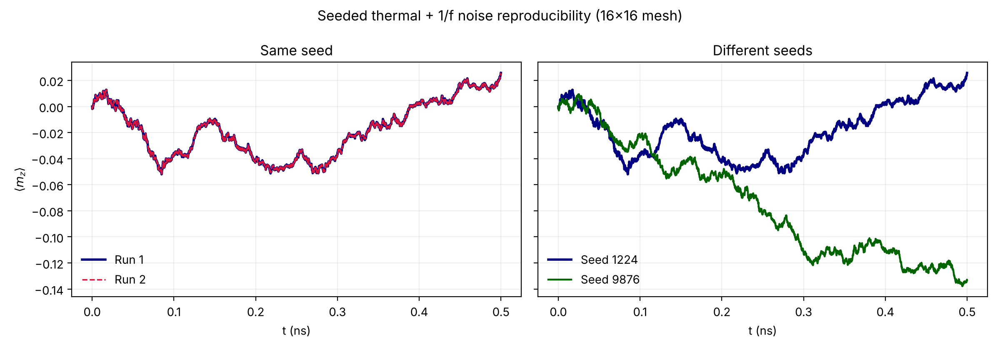
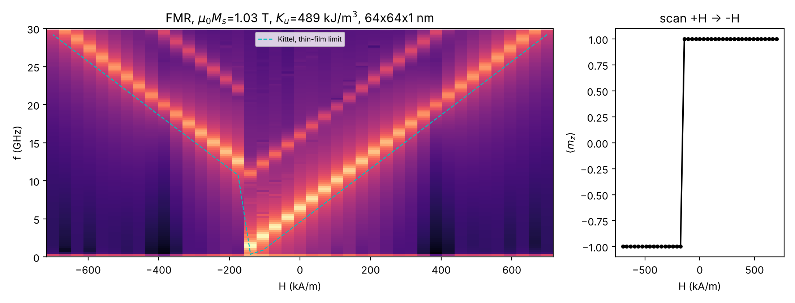
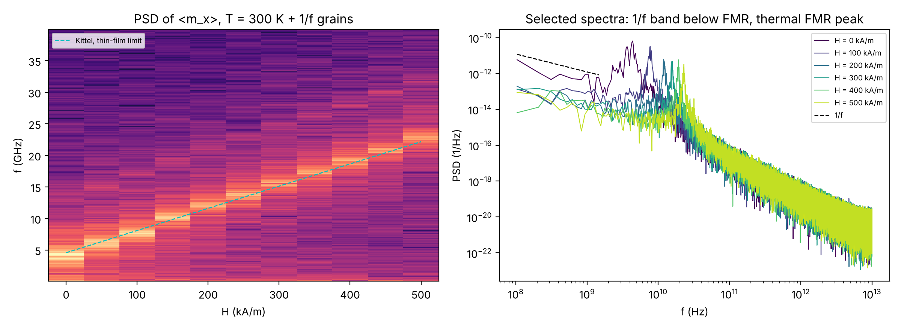
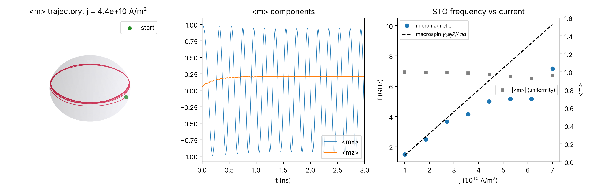
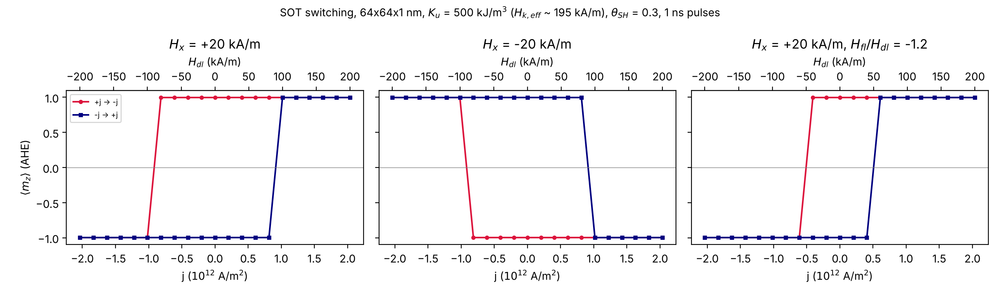

# Curated examples

Micromagnetic counterparts of the [cmtj curated examples](https://github.com/LemurPwned/cmtj/tree/master/curated-examples),
focused on noise and spectra. Run from this directory, e.g. `python fmr_basic.py`.
Figures are written to `results/`, wall times to `results/timings.json`.

| example | cmtj counterpart | what it shows |
| --- | --- | --- |
| `noise_spectra.py` | `cmtj.models.noise` plots | PSD (with fitted exponent), autocorrelation and traces of every 1/f generator |
| `seeded_noise_demo.py` | `seeded-noise-demo.py` | same seed gives a bit-identical thermal + 1/f trajectory |
| `fmr_basic.py` | `fmr-basic.py` | pulse-excited FMR field scan of a PMA element with hysteresis (relax + RK45) |
| `sto.py` | `sto.py` | STT oscillator (in-plane free layer, perpendicular polariser): trajectory and f(j) vs the macrospin law f = gamma0 aJ P / (4 pi alpha) |
| `sot_switching.py` | `cims-hysteresis.py` | SOT switching loops of a PMA element; polarity reverses with H_x, field-like torque lowers the switching current |
| `domain_noise.py` | (new) | thermal <m> noise of an element made of N bars with dispersed PMA / IMA anisotropy (magnitude and axis, sigma); spectra vs N and sigma, GIFs of m_x, m_y, m_z |
| `noise_spectrogram.py` | (new) | spectra driven only by thermal + 1/f grain noise vs field (stochastic Heun); the thermal FMR line follows Kittel, the 1/f band (fit α = 1.02 at H = 0) is pushed under the thermal floor as the field stiffens m |

| PMA bars | IMA bars | mixed PMA / IMA bars |
| --- | --- | --- |
|  |  |  |

## Timings

| example | mesh | work | solver | wall time |
| --- | --- | --- | --- | --- |
| noise_spectra | - | 1,048,576 samples x 6 generators | - | 2.53 s |
| seeded_noise_demo | 16x16x1 | 3 runs x 0.5 ns | heun | 3.39 s |
| fmr_basic | 16x16x1 | 41 fields x 4 ns (327,954 RK45 steps) | relax + rk45 | 213.38 s |
| noise_spectrogram | 16x16x1 | 11 fields x 16 ns (3,520,000 steps) | heun (dt = 50 fs) | 857.07 s |
| sto | 16x16x1 | 8 currents x 6 ns (95,992 RK45 steps) | rk45 | 96.09 s |
| sot_switching | 16x16x1 | 3 loops x 50 pulses of 1 ns (292,580 RK45 steps) | rk45 pulse + relax | 286.65 s |
| domain_noise_sweep_pma | 32x8x1 | 36 runs x 6 ns at 300 K (4 N x 3 sigma x 3 seeds) | relax + heun | 604.71 s |
| domain_noise_sweep_ima | 32x8x1 | 36 runs x 6 ns at 300 K (4 N x 3 sigma x 3 seeds) | relax + heun | 609.32 s |
| domain_noise_gif_pma | 32x8x1 | 2 ns, 100 frames, N = 4, sigma = 0.5 | relax + heun | 5.46 s |
| domain_noise_gif_ima | 32x8x1 | 2 ns, 100 frames, N = 4, sigma = 0.5 | relax + heun | 4.94 s |
| domain_noise_gif_mixed | 32x8x1 | 2 ns, 100 frames, N = 4, sigma = 0.5 | relax + heun | 5.48 s |

Generator throughput (16 channels per tick):

| generator | M samples/s |
| --- | --- |
| Kasdin buffered, α=1 | 8.31 |
| OU sum, α=0.5 | 2.79 |
| OU sum, α=1 | 2.81 |
| OU sum, α=1.5 | 2.72 |
| OneF (cmtj), 20 sources | 1.12 |
| VectorAlpha x-comp, α=1 | 3.16 |

Measured on a 4-core cloud container (numba parallel + scipy.fft workers), one job at a time.

