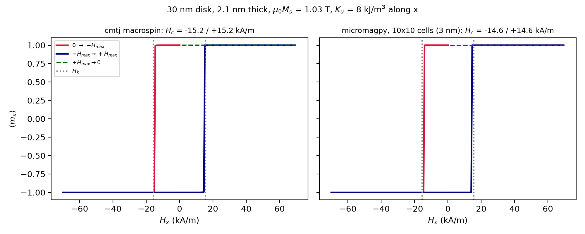
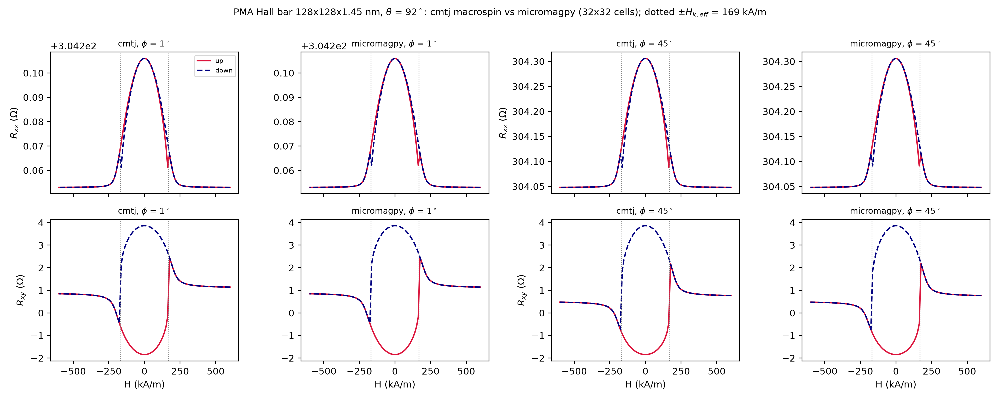
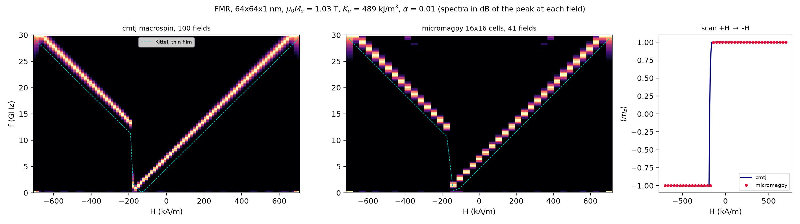
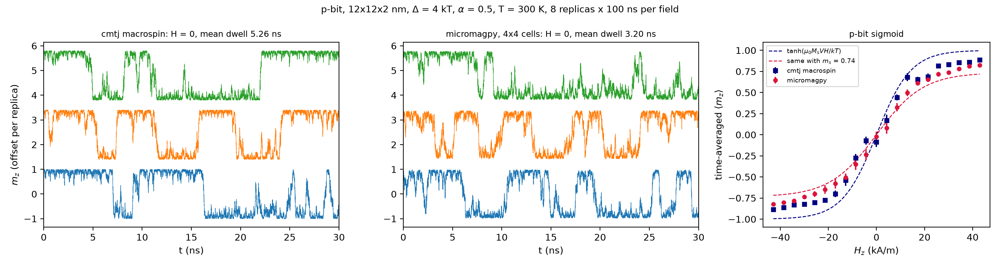
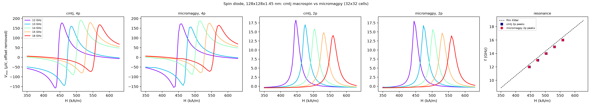

# Macrospin (cmtj) vs micromagnetics (micromagpy)

Each script here runs [cmtj](https://github.com/LemurPwned/cmtj) on the device of one micromagnetic example and puts the two results side by side. The macrospin is built with `_common.macrospin`: same Ms, Ku, damping and volume, with the element's demag factors (N_xx, N_yy, N_zz) from micromagpy's demag tensor rather than a thin-film tensor. Both models then share the same anisotropy and shape, and every difference comes from exchange-coupled, non-uniform magnetisation. The drive protocol is the micromagnetic example's. FMR, STO, the SOT loops and the SOT phase diagram use cmtj's sampling in both models (100 fields; 25 currents; 2·j_max/130 current steps; 50×50 × 8 replicas). The p-bit and spin-diode scans use a denser grid for the macrospin.

For one cell (no exchange, no demag) the two codes agree to 5 decimals with field, anisotropy, SOT and STT, so the comparisons below test the physics, not conventions.

Run a micromagnetic example first (it saves `results/<name>.npz`), then the comparison:

```bash
pip install cmtj
python examples/curated/switching/switching_hysteresis.py
python examples/curated/compare/switching_hysteresis.py   # -> compare/results/switching-hysteresis.png
```

## Field-driven hysteresis ([`switching_hysteresis.py`](switching_hysteresis.py))

**Timing:** cmtj 10.9 s · micromagpy JAX 4.0 s (Mac CPU) / 14.5 s (GB10), numba 22 s · 480 fields each



The 30 nm disk is nearly a macrospin. The macrospin reverses at 15.2 kA/m, close to the Stoner-Wohlfarth H_k = 15.5 kA/m. The 10×10 mesh reverses 4 % earlier, at 14.6 kA/m, through a slightly non-uniform (buckling) state.

## Rxx / Rxy sweeps ([`magnetoresistance.py`](magnetoresistance.py))

**Timing:** cmtj 9.3 s · micromagpy JAX 71 s (Mac CPU) / 42 s (GB10), numba 89 s · 400 fields each



The two models are practically identical, including the switching fields and the shape of the rotation below H_k,eff. For this 128 nm element the cell-averaged magnetisation behaves like one moment over the whole sweep, so here a macrospin is enough.

## Pulse-excited FMR ([`fmr_basic.py`](fmr_basic.py))

**Timing:** cmtj 1.8 s · micromagpy JAX 156 s (Mac CPU) / 286 s (GB10), numba 803 s · 100 fields each



Both show the same uniform-mode line, and both sit above the thin-film Kittel law by the same amount, because the 64 nm element's in-plane demag is not zero. The mesh reverses one field step earlier on the −H branch: between −163 and −177 kA/m, against −177 to −191 kA/m for the macrospin. The mesh also shows a weak higher-order mode near 28 GHz around ±400 kA/m, which a macrospin cannot have.

## Spin-transfer oscillator ([`sto.py`](sto.py))

**Timing:** cmtj 0.4 s · micromagpy JAX 8.7 s (GB10) · 25 currents each (8 currents: JAX 17 s Mac CPU, numba 90 s)


The macrospin follows the analytic f = γ₀ a_J P / 4πα over the whole range. The mesh agrees up to j ≈ 2.2 × 10¹⁰ A/m². Above that, the precession becomes non-uniform (|⟨m⟩| falls from 0.995 to 0.91) and the frequency locks onto plateaus instead of rising linearly: about 4.0 GHz for 3.0–3.75, 5.0–5.3 GHz for 4.0–6.75 and 7.2 GHz at 7 × 10¹⁰ A/m². The macrospin overestimates it by up to 1.8×.

## SOT switching loops ([`sot_switching.py`](sot_switching.py))

**Timing:** cmtj 13 s · micromagpy JAX 548 s (Mac CPU) / 251 s (GB10), numba 3093 s · 3 loops × 261 pulses each


At T = 0 the switching polarity and thresholds agree within 3 % (one sweep step): ±1.00 × 10¹² A/m² for the macrospin and ±0.97 × 10¹² A/m² for the mesh. The field-like torque (H_fl/H_dl = −1.2) lowers both to ±0.60 × 10¹² A/m². The mesh's m_z then flips back and forth on successive pulses between 0.60 and 0.66 × 10¹² A/m² before switching settles; the macrospin switches cleanly once.

## SOT phase diagram at 300 K ([`sot_phase_diagram.py`](sot_phase_diagram.py))

**Timing:** cmtj 7.5 s (18 processes) · micromagpy 1049 s (JAX float32, GB10 GPU) · 20 000 runs × 2 ns each


Here the models differ most. At |H_x| = 60 kA/m the macrospin needs ≳ 0.6 × 10¹² A/m², while the mesh switches from ≈ 0.35–0.5 × 10¹² A/m². At T = 0 the thresholds agree (previous figure), so the gap comes from thermal fluctuations, which help a non-uniform reversal far more than a rigid moment. The macrospin's switched lobes show ringing (the outcome depends on the precession phase at the end of the pulse), which the mesh smears out. Near the overdrive edge the mesh gives random outcomes over a wider band.

## p-bit ([`p_bit.py`](p_bit.py))

**Timing:** cmtj 7.3 s (18 processes) · micromagpy 107 s (JAX float64, GB10 GPU) · 168 runs × 100 ns each



Both have the same macrospin barrier, Δ = 4 kT. The 16-cell mesh hops faster (mean dwell 3.2 vs 5.3 ns): with internal degrees of freedom the reversal does not have to cross the full coherent-rotation barrier. Its moment is reduced to m_s ≈ 0.74, so the sigmoid saturates lower. The macrospin's time average also stays below tanh(μ₀MₛVH/kT), because it fluctuates within each well.

## Spin diode ([`spin_diode.py`](spin_diode.py))

**Timing:** cmtj 9.2 s (1000 runs, 18 processes) · micromagpy 1409 s (JAX float32, GB10 GPU, 600 runs)



The lines are identical in shape, amplitude and position: a saturated 128 nm element precesses uniformly at these drive levels. The ~10 kA/m offset from the film Kittel law is reproduced by the macrospin with the element's demag factors, which confirms that it is shape anisotropy.

## Timings

All on a Mac M5 Pro unless marked GB10. cmtj uses one process, or a pool of 18 for the thermal and batched scans. micromagpy runs use the JAX backend, float64, on the Mac CPU unless marked GB10; the numba times (one thread) are kept for reference. The GPU runs are on the NVIDIA GB10 (DGX Spark).

| Comparison | Macrospin work | cmtj | micromagpy |
|---|---|---|---|
| switching_hysteresis | 480 fields × 10 ns | 10.9 s | 4.0 s (JAX; numba 22 s) |
| magnetoresistance | 400 fields × 10 ns | 9.3 s | 42 s (JAX GB10; numba 89 s) |
| fmr_basic | 100 fields × 9 ns | 1.8 s | 156 s (JAX; numba 803 s) |
| sto | 25 currents × 6 ns | 0.4 s | 8.7 s (JAX GB10; numba 90 s for 8 currents) |
| sot_switching | 3 × 261 pulses | 13 s | 251 s (JAX GB10; numba 3093 s) |
| sot_phase_diagram | 20 000 runs × 2 ns, 300 K | 7.5 s | 1049 s (JAX GPU) |
| p_bit | 168 runs × 100 ns, 300 K | 7.3 s | 107 s (JAX GPU) |
| spin_diode | 1000 runs × 20 ns | 9.2 s | 1409 s (JAX GPU, 600 runs) |
