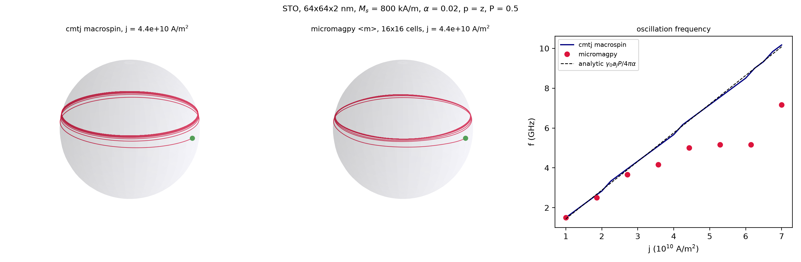
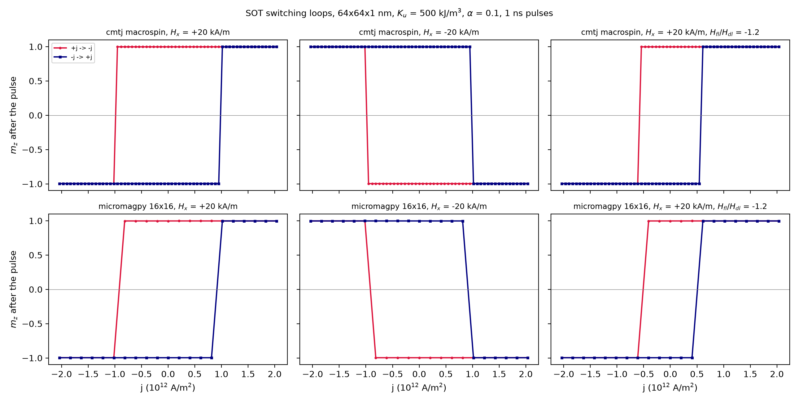
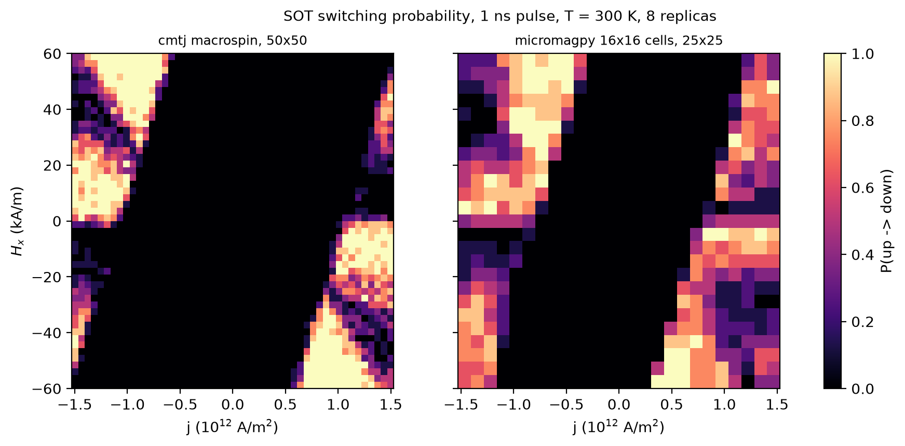

# Macrospin (cmtj) vs micromagnetics (micromagpy)

Each script here runs [cmtj](https://github.com/LemurPwned/cmtj) on the device of one micromagnetic example and puts the two results side by side. The macrospin is built with `_common.macrospin`: same Ms, Ku, damping and volume, with the element's demag factors (N_xx, N_yy, N_zz) from micromagpy's demag tensor rather than a thin-film tensor. Both models then share the same anisotropy and shape, and every difference comes from exchange-coupled, non-uniform magnetisation. The drive protocol is the micromagnetic example's. The macrospin scans are as dense as or denser than the originals in `cmtj/curated-examples`, while the micromagnetic scans are coarser.

For one cell (no exchange, no demag) the two codes agree to 5 decimals with field, anisotropy, SOT and STT, so the comparisons below test the physics, not conventions.

Run a micromagnetic example first (it saves `results/<name>.npz`), then the comparison:

```bash
pip install cmtj
python examples/curated/switching/switching_hysteresis.py
python examples/curated/compare/switching_hysteresis.py   # -> compare/results/switching-hysteresis.png
```

## Field-driven hysteresis ([`switching_hysteresis.py`](switching_hysteresis.py))


The 30 nm disk is nearly a macrospin. The macrospin reverses at 15.2 kA/m, close to the Stoner-Wohlfarth H_k = 15.5 kA/m. The 10×10 mesh reverses 4 % earlier, at 14.6 kA/m, through a slightly non-uniform (buckling) state.

## Rxx / Rxy sweeps ([`magnetoresistance.py`](magnetoresistance.py))


The two models are practically identical, including the switching fields and the shape of the rotation below H_k,eff. For this 128 nm element the cell-averaged magnetisation behaves like one moment over the whole sweep, so here a macrospin is enough.

## Pulse-excited FMR ([`fmr_basic.py`](fmr_basic.py))


Both show the same uniform-mode line, and both sit above the thin-film Kittel law by the same amount, because the 64 nm element's in-plane demag is not zero. The mesh reverses earlier on the −H branch (≈ −150 vs −190 kA/m), so its line jumps to the reversed branch sooner. A non-uniform reversal path lowers the switching field, as in the hysteresis loop.

## Spin-transfer oscillator ([`sto.py`](sto.py))



The macrospin follows the analytic f = γ₀ a_J P / 4πα over the whole range. The mesh agrees up to j ≈ 2.7 × 10¹⁰ A/m². Above that, the precession becomes non-uniform: |⟨m⟩| falls from 0.995 to 0.93, the frequency stays near 5 GHz between 4.4 and 6.1 × 10¹⁰ A/m², and the macrospin overestimates it by up to 1.7×.

## SOT switching loops ([`sot_switching.py`](sot_switching.py))



At T = 0 the switching polarity and thresholds agree within one sweep step (~10 %): about 1.0 × 10¹² A/m² for the macrospin and 0.9 × 10¹² A/m² for the mesh. The field-like torque (H_fl/H_dl = −1.2) lowers both thresholds by a similar amount.

## SOT phase diagram at 300 K ([`sot_phase_diagram.py`](sot_phase_diagram.py))



Here the models differ most. At |H_x| = 60 kA/m the macrospin needs ≳ 0.6 × 10¹² A/m², while the mesh switches from ≈ 0.3–0.5 × 10¹² A/m². At T = 0 the thresholds agree (previous figure), so the gap comes from thermal fluctuations, which help a non-uniform reversal far more than a rigid moment. The macrospin's switched lobes show ringing (the outcome depends on the precession phase at the end of the pulse), which the mesh smears out. Near the overdrive edge the mesh gives random outcomes over a wider band.

## p-bit ([`p_bit.py`](p_bit.py))


Both have the same macrospin barrier, Δ = 4 kT. The 16-cell mesh hops faster (mean dwell 3.2 vs 5.3 ns): with internal degrees of freedom the reversal does not have to cross the full coherent-rotation barrier. Its moment is reduced to m_s ≈ 0.74, so the sigmoid saturates lower. The macrospin's time average also stays below tanh(μ₀MₛVH/kT), because it fluctuates within each well.

## Spin diode ([`spin_diode.py`](spin_diode.py))


The lines are identical in shape, amplitude and position: a saturated 128 nm element precesses uniformly at these drive levels. The ~10 kA/m offset from the film Kittel law is reproduced by the macrospin with the element's demag factors, which confirms that it is shape anisotropy.

## Timings

The cmtj macrospin runs took seconds on a Mac M5 Pro, with a pool of 18 processes for the thermal and batched scans. The micromagnetic runs are listed in the [curated README](../README.md#timings).

| Comparison | Macrospin work | cmtj | micromagpy |
|---|---|---|---|
| switching_hysteresis | 480 fields × 10 ns | 10.9 s | 22 s (numba) |
| magnetoresistance | 400 fields × 10 ns | 9.3 s | 89 s (numba) |
| fmr_basic | 100 fields × 9 ns | 2.0 s | 213 s (numba, 41 fields) |
| sto | 25 currents × 6 ns | 0.9 s | 96 s (numba, 8 currents) |
| sot_switching | 3 × 151 pulses | 6.9 s | 287 s (numba, 3 × 40) |
| sot_phase_diagram | 20 000 runs × 2 ns, 300 K | 42 s | 242 s (JAX GPU, 5000 runs) |
| p_bit | 168 runs × 100 ns, 300 K | 7.3 s | 107 s (JAX GPU) |
| spin_diode | 1000 runs × 20 ns | 9.2 s | 1409 s (JAX GPU, 600 runs) |
