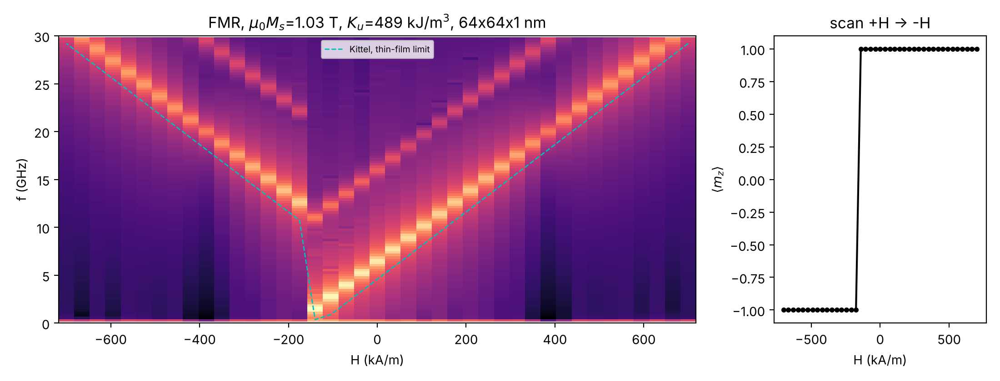

# FMR field scan of a PMA element

Script: [`../fmr_basic.py`](../fmr_basic.py) · cmtj counterpart: `fmr-basic.py` · wall time 213 s

The element is 64×64×1 nm with μ0Ms = 1.03 T, Ku = 489 kJ/m³ and α = 0.01, using the free-layer parameters of the cmtj example. The out-of-plane field is scanned from +700 to −700 kA/m in 41 steps.

At each field:
1. the state is relaxed with the energy minimiser, starting from the previous state so the hysteresis is kept;
2. a 50 ps in-plane field pulse excites the dynamics, integrated for 4 ns with adaptive RK45;
3. the FFT of ⟨m_x⟩ gives the spectrum.

What the scan shows:
- **Branches:** a V-shaped Kittel branch, then the metastable +z branch softening towards 0 GHz before the element switches at about −150 kA/m.
- **Kittel offset:** the line sits above the thin-film estimate because the finite element has N_zz < 1.
- **Solver choice:** fixed-step Euler is unstable here (4 nm cells at α = 0.01), so the scan uses relax + RK45.
- **Difference from cmtj:** cmtj's example has three coupled layers; micromagpy has no interlayer coupling, so this simulates the free layer only.
