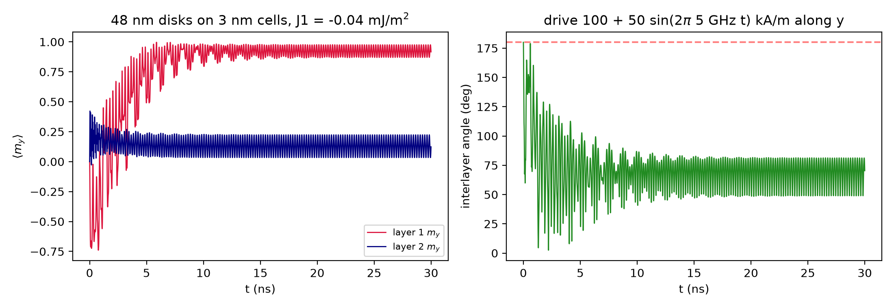

# IEC-coupled oscillations

Script: [`../iec_coupling.py`](../iec_coupling.py) · cmtj counterpart: `iec-coupling.py` · wall time JAX 112 s (Mac CPU, 30 ns, adaptive RK45)

Two perpendicular layers (Ms = 1.0 / 1.2 T, Ku = 300 / 800 kJ/m³, 1.4 / 3 nm thick, α = 0.011) are coupled antiferromagnetically through a 1 nm spacer, J1 = −4 × 10⁻⁵ J/m², and driven along y by 100 kA/m + 50 kA/m · sin(2π · 5 GHz · t). They start antiparallel (up / down). Each layer is a 48 nm disk on 3 nm cells, built with `micromagpy.stack.Stack`. The demag fields of both layers act on each other (Newell tensors for the real gap).

Panels:
- **left:** ⟨m_y⟩ of both layers;
- **right:** the angle between the layers.

The bias tilts both layers towards y within about 8 ns. After that they oscillate at the drive frequency. Over the last 15 ns the mean angle between the layers is 68°. The same run without the layers' dipolar fields on each other, which a macrospin code also lacks, gives 88°. So in this geometry the interlayer dipolar field brings the layers about 20° closer together, comparable to the IEC itself (|J1|/(μ0 Ms t) ≈ 29 kA/m on the thin layer).
