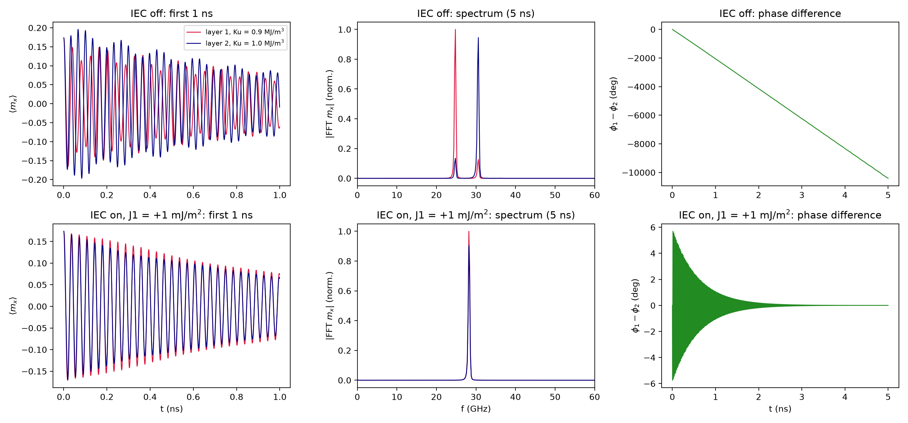
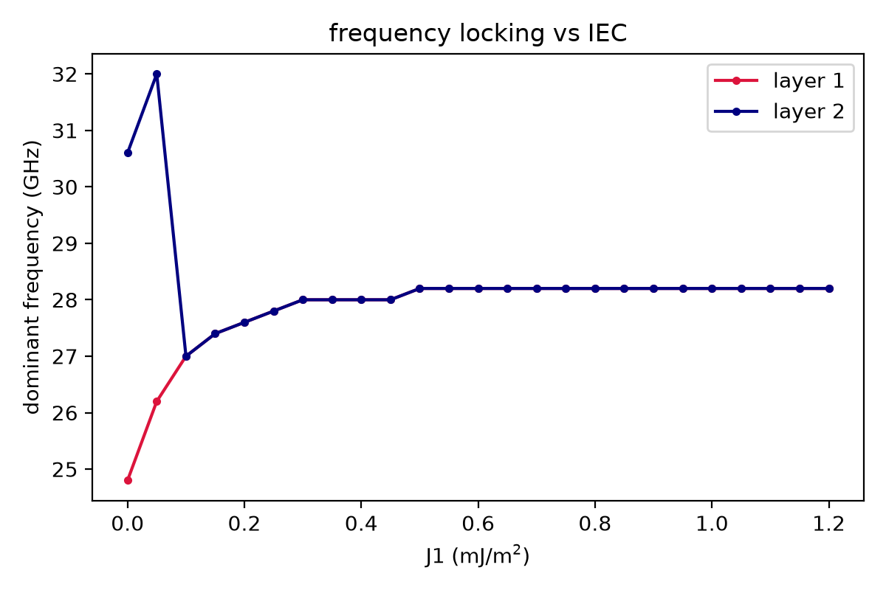

# IEC synchronises two PMA layers

Script: [`../iec_sync.py`](../iec_sync.py) · no cmtj counterpart · wall time JAX 39 s (Mac CPU, 27 runs × 5 ns in one `vmap`)

The two layers are 1 nm thick: Ms = 1 MA/m, α = 0.005, and perpendicular Ku = 0.9 and 1.0 MJ/m³. They sit on a 1 nm spacer and are 32 nm disks on 4 nm cells. H_z = 100 kA/m. Both start tilted 10° towards x and ring down for 5 ns. The runs compare IEC off with ferromagnetic IEC on, J1 = +1 mJ/m². The coupling field is J1/(μ0 Ms t) = 0.8 MA/m, well above the difference between the layers' anisotropy fields, 2ΔKu/(μ0 Ms) = 0.16 MA/m.

Rows: IEC off (top) and on (bottom). Panels:
- **left:** ⟨m_x⟩ over the first ns;
- **middle:** spectrum over 5 ns;
- **right:** precession phase difference φ1 − φ2, with φ = atan2(⟨m_y⟩, ⟨m_x⟩).

| | layer 1 (Ku = 0.9) | layer 2 (Ku = 1.0) | phase drift over 5 ns |
| --- | --- | --- | --- |
| IEC off | 24.8 GHz | 30.6 GHz | −10 410° (= 5.8 GHz × 5 ns) |
| IEC on | 28.2 GHz | 28.2 GHz | 0° |

With IEC off, each layer precesses at its own frequency. The phase difference grows linearly, and the two lines in the spectrum come from the weak dipolar coupling between the layers. With IEC on, the layers precess as one acoustic mode at a common frequency between the two. The initial ±6° phase wobble decays within about 3 ns, and the phase then stays locked.

The J1 sweep shows each layer's dominant frequency over 25 values of J1 in a single `vmap`. The two frequencies merge at J1 ≈ 0.1 mJ/m². Above that the common frequency rises slowly to 28.2 GHz (the spectral resolution is 0.2 GHz). At J1 = 0.05 mJ/m² the two modes repel: layer 2's line moves up to 32 GHz before the locking sets in.
