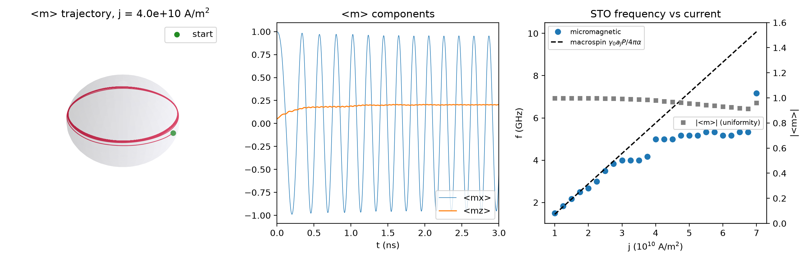

# Spin-transfer oscillator

Script: [`../sto.py`](../sto.py) · cmtj counterpart: `sto.py` · wall time JAX 8.7 s (GB10, 25 currents); 8 currents: JAX 17 s (Mac CPU), numba 90 s

The device is a 64×64×2 nm in-plane free layer (Ms = 800 kA/m, α = 0.02) with a perpendicular polariser p = z. The torque is cmtj-style Slonczewski STT with P = 0.5 and Λ = 1, so η = P/2. Each current runs for 6 ns with adaptive RK45.

Above threshold, the damping-like torque balances damping on an out-of-plane precession orbit. The macrospin limit then gives m_z = a_J·η/(α·Ms) and a frequency linear in current, f = γ0·a_J·P/(4πα).

Panels:
- **left:** trajectory of ⟨m⟩ on the unit sphere;
- **middle:** time traces;
- **right:** frequency (from zero crossings of ⟨m_x⟩) vs current, with |⟨m⟩| as a uniformity measure.

25 currents from 1 to 7 × 10¹⁰ A/m² (every third shown):

| j (10¹⁰ A/m²) | 1.00 | 1.75 | 2.50 | 3.25 | 4.00 | 4.75 | 5.50 | 6.25 | 7.00 |
| --- | --- | --- | --- | --- | --- | --- | --- | --- | --- |
| f micromagnetic (GHz) | 1.50 | 2.50 | 3.50 | 4.00 | 5.00 | 5.17 | 5.33 | 5.17 | 7.17 |
| f macrospin (GHz) | 1.44 | 2.52 | 3.60 | 4.68 | 5.76 | 6.84 | 7.92 | 9.00 | 10.08 |
| \|⟨m⟩\| | 0.998 | 0.997 | 0.996 | 0.991 | 0.980 | 0.962 | 0.944 | 0.925 | 0.961 |

The micromagnetic frequency follows the macrospin law while precession stays uniform, up to about 2.2 × 10¹⁰ A/m². Above that the precession becomes non-uniform and the frequency locks onto plateaus instead of rising: 4.0 GHz for 3.0–3.75, 5.0–5.3 GHz for 4.0–6.75 and 7.2 GHz at 7.0 × 10¹⁰ A/m². The zero-crossing count over the last 3 ns resolves about 0.17 GHz, much finer than the plateaus.
