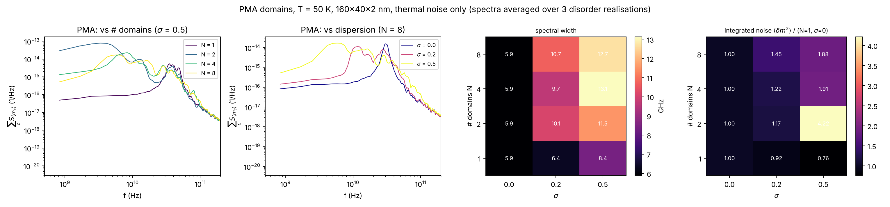
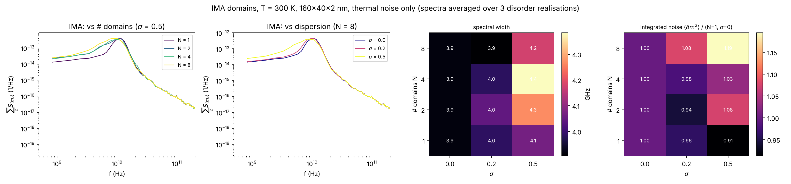
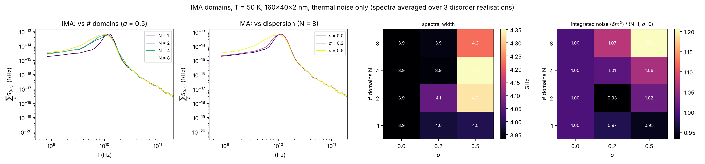
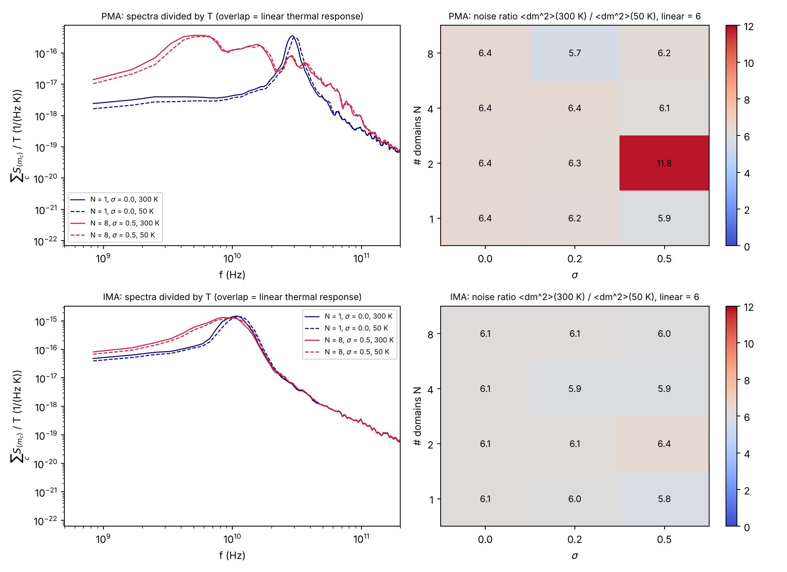
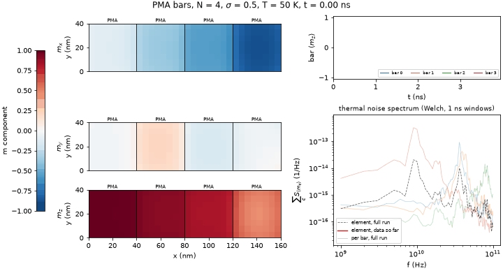
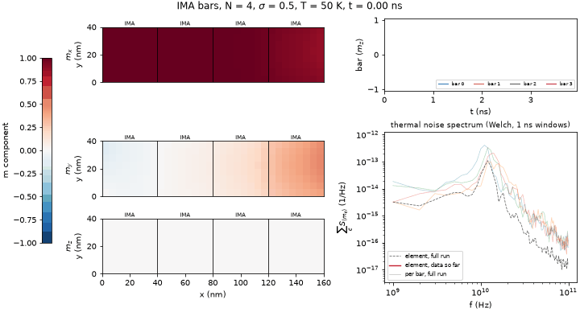
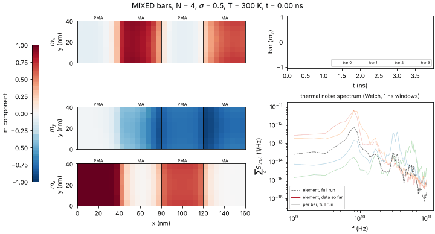

# Thermal noise of domains with dispersed PMA / IMA anisotropy

Script: [`../domain_noise.py`](../domain_noise.py) · new example

## Setup
- **Element:** 160×40×2 nm (32×8×1 cells, Ms = 800 kA/m, A = 13 pJ/m, α = 0.05), split into N bars ("domains") along x.
- **Per-bar anisotropy:** bar i has its own magnitude and axis.
  - Magnitude: K_i = K0·(1 + σ·ξ_i), with ξ ~ N(0, 1), clipped at 0.05·K0.
  - Axis: tilted by an angle ~ N(0, σ) rad from the nominal direction.
  - **PMA:** K0 = 800 kJ/m³ around z, so K_eff ≈ 400 kJ/m³; the tilt azimuth is random.
  - **IMA:** K0 = 50 kJ/m³ around x, in-plane.
  - **Mixed:** PMA and IMA bars alternate.
- **Protocol:**
  1. relax with the energy minimiser;
  2. 6 ns with a white thermal field in every cell (same global T), stochastic Heun with dt = 0.1 ps;
  3. record S(f) = Σ_c S_⟨m_c⟩(f), the PSD of the total ⟨m⟩ noise.
- **Sweep:** N ∈ {1, 2, 4, 8} × σ ∈ {0, 0.2, 0.5}, each point averaged over 3 disorder realisations, at **300 K** and **50 K**.

Regenerate:

```bash
python domain_noise.py sweep --temperature 300
python domain_noise.py sweep --temperature 50
python domain_noise.py gif --temperature 300
python domain_noise.py gif --temperature 50
python domain_noise.py compare --compare 300,50
```

## Spectra vs number of domains and dispersion
Each figure has four panels:
1. PSD vs N at σ = 0.5;
2. PSD vs σ at N = 8;
3. spectral width;
4. integrated noise ⟨δm²⟩, normalised to N = 1, σ = 0.

### PMA, 300 K


### PMA, 50 K


### IMA, 300 K


### IMA, 50 K


Each cell below gives spectral centroid / spectral width / integrated noise relative to (N = 1, σ = 0).

**PMA, 300 K**

| N \ σ | 0.0 | 0.2 | 0.5 |
| --- | --- | --- | --- |
| 1 | 29.1 GHz / 5.8 GHz / 1.00 | 32.2 GHz / 6.4 GHz / 0.90 | 37.8 GHz / 8.6 GHz / 0.70 |
| 2 | 29.1 GHz / 5.8 GHz / 1.00 | 23.9 GHz / 9.6 GHz / 1.15 | 4.4 GHz / 8.1 GHz / 7.80 |
| 4 | 29.1 GHz / 5.8 GHz / 1.00 | 25.0 GHz / 9.6 GHz / 1.21 | 16.5 GHz / 12.8 GHz / 1.84 |
| 8 | 29.1 GHz / 5.8 GHz / 1.00 | 23.6 GHz / 10.3 GHz / 1.29 | 16.0 GHz / 12.5 GHz / 1.82 |

**PMA, 50 K**

| N \ σ | 0.0 | 0.2 | 0.5 |
| --- | --- | --- | --- |
| 1 | 30.6 GHz / 5.9 GHz / 1.00 | 33.8 GHz / 6.4 GHz / 0.92 | 39.4 GHz / 8.4 GHz / 0.76 |
| 2 | 30.6 GHz / 5.9 GHz / 1.00 | 24.8 GHz / 10.1 GHz / 1.17 | 8.7 GHz / 11.5 GHz / 4.22 |
| 4 | 30.6 GHz / 5.9 GHz / 1.00 | 26.5 GHz / 9.7 GHz / 1.22 | 16.8 GHz / 13.1 GHz / 1.91 |
| 8 | 30.6 GHz / 5.9 GHz / 1.00 | 23.3 GHz / 10.7 GHz / 1.45 | 16.9 GHz / 12.7 GHz / 1.88 |

**IMA, 300 K**

| N \ σ | 0.0 | 0.2 | 0.5 |
| --- | --- | --- | --- |
| 1 | 10.8 GHz / 3.9 GHz / 1.00 | 11.1 GHz / 4.0 GHz / 0.96 | 11.4 GHz / 4.1 GHz / 0.91 |
| 2 | 10.8 GHz / 3.9 GHz / 1.00 | 11.0 GHz / 4.0 GHz / 0.94 | 10.3 GHz / 4.3 GHz / 1.08 |
| 4 | 10.8 GHz / 3.9 GHz / 1.00 | 11.0 GHz / 4.0 GHz / 0.98 | 10.1 GHz / 4.4 GHz / 1.03 |
| 8 | 10.8 GHz / 3.9 GHz / 1.00 | 10.5 GHz / 3.9 GHz / 1.08 | 9.4 GHz / 4.2 GHz / 1.19 |

**IMA, 50 K**

| N \ σ | 0.0 | 0.2 | 0.5 |
| --- | --- | --- | --- |
| 1 | 11.5 GHz / 3.9 GHz / 1.00 | 11.7 GHz / 4.0 GHz / 0.97 | 12.0 GHz / 4.0 GHz / 0.95 |
| 2 | 11.5 GHz / 3.9 GHz / 1.00 | 11.6 GHz / 4.1 GHz / 0.93 | 10.9 GHz / 4.3 GHz / 1.02 |
| 4 | 11.5 GHz / 3.9 GHz / 1.00 | 11.6 GHz / 3.9 GHz / 1.01 | 10.6 GHz / 4.4 GHz / 1.06 |
| 8 | 11.5 GHz / 3.9 GHz / 1.00 | 11.1 GHz / 3.9 GHz / 1.07 | 10.0 GHz / 4.2 GHz / 1.21 |

### Observations
- **σ = 0:** the spectrum is identical for every N, as it must be. The bars are then the same material and exchange-coupled.
- **PMA is very sensitive to anisotropy dispersion once there are several domains.** At N = 4–8 and σ = 0.5:
  - the spectral centroid falls from ~30 to ~16 GHz;
  - the width roughly doubles (6 → 12–13 GHz);
  - the integrated noise grows ~1.8–1.9×.
- **Cause of the PMA change:** bars whose K drops below μ0Ms²/2 lose their perpendicular stiffness. They become soft, effectively in-plane, regions that add strong low-frequency noise.
- **The N = 2, σ = 0.5 outlier:** in one realisation half of the element went soft, which gives a 7.8× rise at 300 K.
- **IMA barely reacts:** the in-plane shape anisotropy dominates the small IMA K. The width stays ~4 GHz, and the integrated noise changes by at most ~1.2×, with the FMR line slightly red-shifted.

## 300 K vs 50 K


- **Linear regime:** for a linear (small-fluctuation) thermal response, S(f)/T is independent of temperature and the noise ratio between 300 K and 50 K is 6.
- **Most configurations follow it:** the measured ratio is 5.7–6.4 for both PMA and IMA, and the T-normalised spectra overlap (left panels).
- **Thermal softening:** the FMR peak at 300 K sits slightly below the 50 K one, because thermal fluctuations reduce the effective anisotropy.
- **The exception is PMA with N = 2 and σ = 0.5,** where the ratio is 11.8. The soft bar there responds non-linearly, so its noise grows faster than T. This ratio is a simple diagnostic for soft or nearly unstable regions.

## Animations
N = 4 bars, σ = 0.5. Each GIF shows:
- the m_x, m_y and m_z maps with bar boundaries and each bar's anisotropy type;
- per-bar ⟨m_z⟩ traces;
- the noise spectrum. The red line is the running Welch estimate (1 ns windows) from the data so far, converging to the full-run element spectrum (dashed). Faint lines are the per-bar spectra.

| | 300 K | 50 K |
| --- | --- | --- |
| PMA bars |  |  |
| IMA bars |  |  |
| mixed PMA / IMA |  |  |

## Timings (4-core container)
| run | wall time |
| --- | --- |
| `domain_noise_gif_ima_T300` | 15.16 s |
| `domain_noise_gif_ima_T50` | 12.06 s |
| `domain_noise_gif_mixed_T300` | 14.84 s |
| `domain_noise_gif_mixed_T50` | 11.9 s |
| `domain_noise_gif_pma_T300` | 15.5 s |
| `domain_noise_gif_pma_T50` | 12.23 s |
| `domain_noise_sweep_ima_T300` | 609.32 s |
| `domain_noise_sweep_ima_T50` | 583.12 s |
| `domain_noise_sweep_pma_T300` | 604.71 s |
| `domain_noise_sweep_pma_T50` | 596.08 s |
