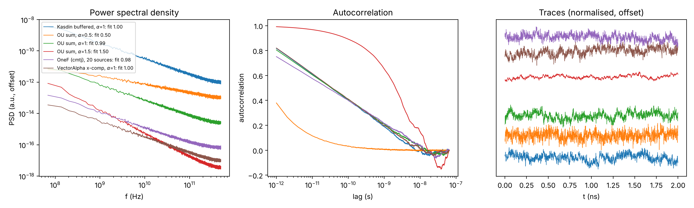

# Noise generator spectra

Script: [`../noise_spectra.py`](../noise_spectra.py) · cmtj counterpart: `cmtj.models.noise` plots · wall time 2.5 s

Every 1/f^α generator in `micromagpy.noise` produces 2^16 samples on 16 independent channels (dt = 1 ps).
For each one the figure shows three panels:
- **left:** Welch PSD with the fitted spectral exponent;
- **middle:** autocorrelation;
- **right:** a short normalised trace.

| generator | target α | fitted α | throughput |
| --- | --- | --- | --- |
| Kasdin buffered (`BufferedAlphaNoise`) | 1.0 | 1.00 | 8.3 M samples/s |
| OU sum (`OUAlphaNoise`) | 0.5 | 0.50 | 2.8 M samples/s |
| OU sum | 1.0 | 0.99 | 2.8 M samples/s |
| OU sum | 1.5 | 1.50 | 2.7 M samples/s |
| `OneFNoise` (cmtj geometric trials, 20 sources) | ~1 | 0.98 | 1.1 M samples/s |
| `VectorAlphaNoise` x component | 1.0 | 1.00 | 3.2 M samples/s |

The OU-sum generator needs no buffer and keeps only a few relaxation states per channel. That makes it the one to use for per-cell 1/f fields on a mesh and for long runs.
