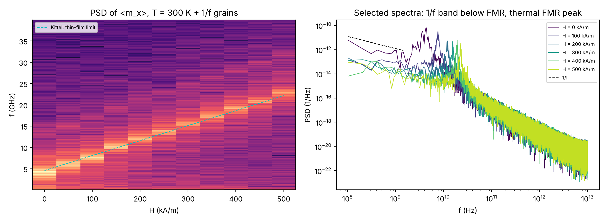

# Noise-driven spectra vs field (thermal + 1/f grains)

Script: [`../noise_spectrogram.py`](../noise_spectrogram.py) · new example · wall time 857 s

The same PMA element as in [`fmr_basic`](fmr_basic.md) is driven only by noise, with no pulse:
- a 300 K white thermal field;
- an independent 1/f field per grain, with 10 Voronoi grains at 20 kA/m rms each.

At each field (0–500 kA/m) the state is relaxed, then integrated with stochastic Heun for 16 ns at dt = 50 fs. The figure shows the Welch PSD of ⟨m_x⟩.

What the spectra show:
- **Thermal FMR:** the thermally excited FMR line follows the Kittel relation.
- **1/f band at zero field:** below FMR the spectrum follows 1/f, with fitted α = 1.02 at H = 0.
- **1/f band at higher field:** as the field stiffens m, the response to the 1/f fields falls (susceptibility ~ 1/(H + H_k,eff)²) and the 1/f band sinks under the thermal floor. Above ~50 kA/m the fitted low-frequency exponents are therefore noise.
