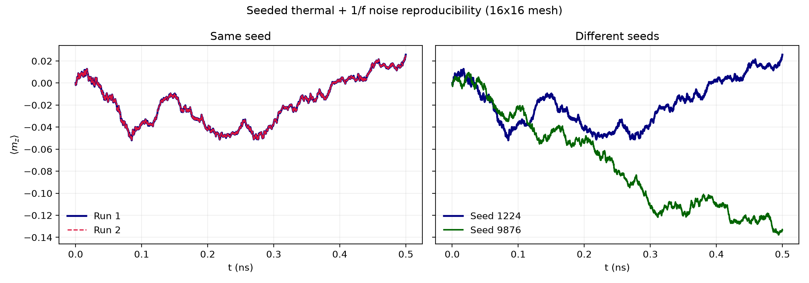

# Seeded thermal + 1/f noise reproducibility

Script: [`../seeded_noise_demo.py`](../seeded_noise_demo.py) · cmtj counterpart: `seeded-noise-demo.py` · wall time 3.4 s

The setup is a 16×16 PMA dot, starting in-plane, with a 100 K thermal field and per-grain 1/f field noise. It is integrated with stochastic Heun for 0.5 ns, three times:
- twice with seed 1224: the traces are bit-identical (the script asserts this);
- once with seed 9876: the trajectory is different.

