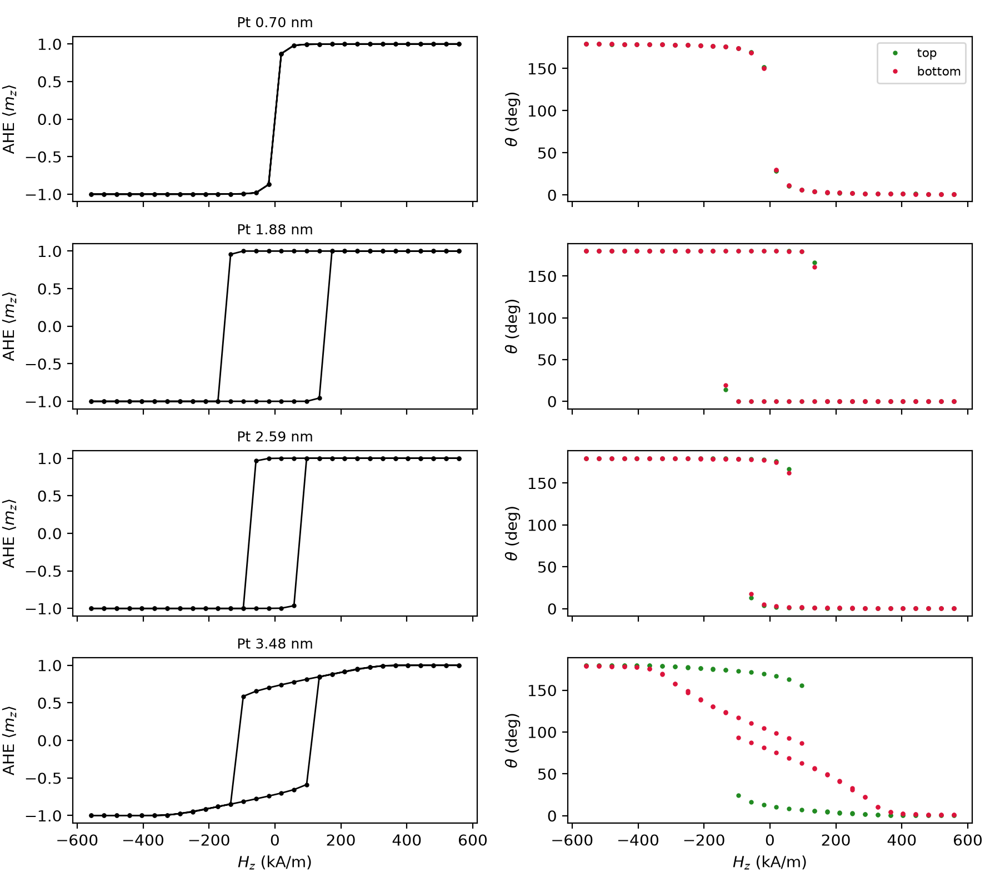

# Co/Pt/Co out-of-plane loops

Script: [`../ahe_loops.py`](../ahe_loops.py) · cmtj counterpart: `ahe_loops.py` · wall time JAX 39 s (Mac CPU, 4 samples × 60 fields)

Each of the four samples has two perpendicular 1 nm Co layers on a Pt spacer of 0.70, 1.88, 2.59 or 3.48 nm. The samples have their own Ms and Ku per layer, easy axes tilted by under 1°, and IEC through the Pt, J = J0 · t_Co / (t_Pt + t_Co). H_z is swept −7000 → +7000 → −7000 Oe (30 points each way), and every point is relaxed from the previous state. The layers are 64 nm squares on 4 nm cells.

cmtj's example creates SOT layers but sets no current driver. With static SOT, cmtj scales the torques by the current, so they are zero there. They are left out here too.

Panels:
- **left:** AHE signal (AHE-weighted ⟨m_z⟩);
- **right:** polar angles of both layers.

Strong IEC (0.70 nm Pt) locks the layers together in a nearly closed loop. At 1.88 and 2.59 nm the layers still switch together, with an open square loop. At 3.48 nm the coupling is weak (0.07 mJ/m²): the softer layer rotates gradually, and the stiffer one switches abruptly inside that rotation.
