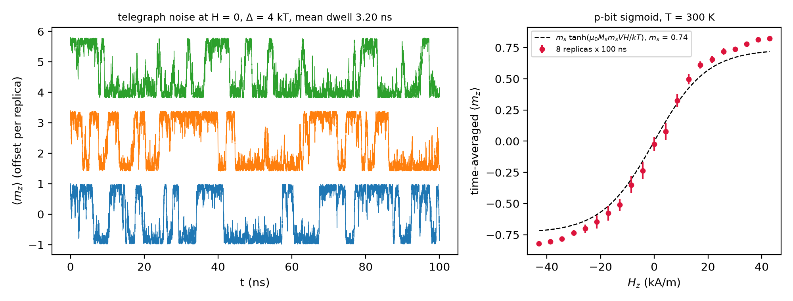

# Probabilistic bit (p-bit)

Script: [`../p_bit.py`](../p_bit.py) · cmtj counterpart: `p-bit.py` · wall time 107 s (JAX, float64, NVIDIA GB10)

The device is a low-barrier PMA element, 12×12×2 nm on 3 nm cells (4×4 cells), with Ms = 800 kA/m and α = 0.5 at 300 K. Ku = 295 kJ/m³ is chosen so that the barrier K_eff V is 4 kT, with the element's shape anisotropy taken from the demag tensor. The large damping keeps the relaxation time (~0.1 ns) well below the dwell time, so the states are clean. The bias field H_z is scanned over 21 values with 8 thermal replicas each, 100 ns per run (10⁶ stochastic Heun steps). That is 168 trajectories, run as one `jax.vmap` batch.

Results:
- **Left:** clean telegraph noise between m_z ≈ ±0.74 at H = 0. The mean dwell time, counted with ±0.5 hysteresis thresholds, is 3.2 ns. That is consistent with Néel-Brown, τ ≈ τ₀ e^Δ with τ₀ ~ 0.1 ns and Δ = 4.
- **Right:** the time-averaged ⟨m_z⟩ against bias field is the p-bit sigmoid. It follows the two-state Boltzmann law m_s tanh(μ0 Ms m_s V H / kT). Here m_s = ⟨|m_z|⟩ = 0.74 is the thermally reduced moment of the 16 cells. At large |H| the points rise above the curve because the field also suppresses thermal fluctuations, so m_s grows with H.

Speed: the GPU batch takes 107 s. The script's `--numba-estimate` extrapolates a short numba run with default threads to 7.4 × 10⁴ s (~20 h). Tiny meshes like this one are dominated by thread overhead (see the README, Performance), so single-threaded numba processes running side by side would be roughly 20–50× faster than that, but still well behind the GPU.
