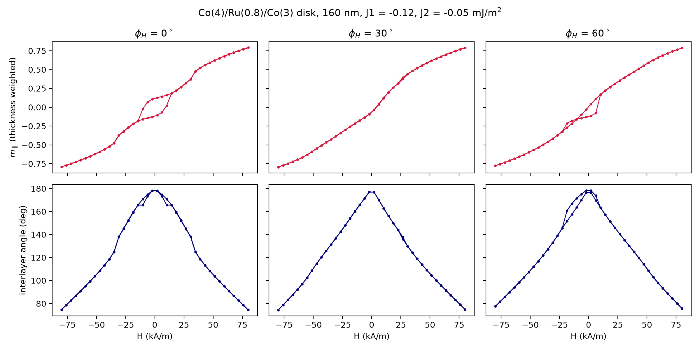

# Co/Ru/Co SAF hysteresis

Script: [`../saf_hysteresis.py`](../saf_hysteresis.py) · cmtj counterpart: `sb-hysteresis-fast.py` · wall time JAX 1046 s (Mac CPU, 3 angles × 80 fields, one `vmap`)

The device is a Co(4 nm)/Ru(0.8 nm)/Co(3 nm) 160 nm disk on 4 nm cells: Ms = 1.65 T, a weak in-plane Ku = 2 kJ/m³ along x, J1 = −0.12 mJ/m² and J2 = −0.05 mJ/m². The in-plane field is swept +80 → −80 → +80 kA/m at 0, 30 and 60° from the easy axis. Every point is relaxed from the previous state. The script repeats the sweep without the layers' dipolar fields on each other (`Stack(..., interlayer_demag=False)`).

Panels:
- **top:** net moment along the field, thickness weighted;
- **bottom:** the angle between the layers.

Interlayer angle on the descending branch:

| H (kA/m) | 80 | 40 | 20 |
| --- | --- | --- | --- |
| full (φ_H = 0 / 30 / 60°) | 75 / 75 / 76° | 118 / 119 / 125° | 159 / 150 / 151° |
| no interlayer dipolar field | 21 / 10 / 12° | 74 / 74 / 78° | 105 / 106 / 111° |

Without the interlayer dipolar field, the disk saturates near the IEC estimate, −(J1 + 2 J2)(1/μ0Ms t1 + 1/μ0Ms t2) ≈ 78 kA/m. With it, the edge fields of each layer act on the other and favour antiparallel alignment. This strengthens the effective antiferromagnetic coupling, so at 80 kA/m the layers are still 75° apart. The effect weakens with size: in the same sweep at φ_H = 0, the angle at 80 kA/m is 112° for one 4 nm cell, 97° for an 80 nm disk and 75° at 160 nm.
