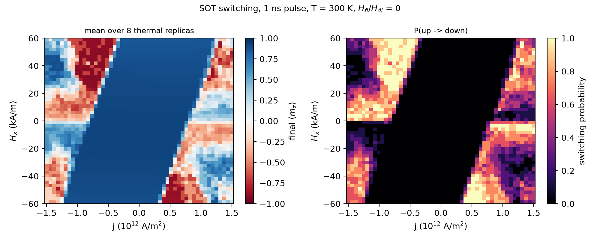

# SOT switching phase diagram at 300 K

Script: [`../sot_phase_diagram.py`](../sot_phase_diagram.py) · cmtj counterpart: `cims-stability-stability-diagram.py` · wall time 1049 s (JAX, float32, NVIDIA GB10)

The device is the element of [`sot_switching`](sot_switching.md): 64×64×1 nm PMA, Ku = 500 kJ/m³, H_k,eff ≈ 190 kA/m, α = 0.1, damping-like SOT with p = y, θ_SH = 0.3. Every run starts in m_z = +1 and gets a 1 ns current pulse, then 1 ns with the current off, at 300 K (stochastic Heun, dt = 0.1 ps). The map has 50 bias fields H_x × 50 current densities × 8 thermal replicas (cmtj's sampling), i.e. 20 000 independent micromagnetic runs, integrated as one `jax.vmap` batch.

Results:
- **No switching** in the central band |j| ≲ 0.3–1.0 × 10¹² A/m². The band narrows as |H_x| grows: the threshold current falls with the in-plane field.
- **Deterministic switching** (P ≈ 1) when j·H_x < 0 and the current is above threshold. These are the two bright lobes, H_x > 0 with j < 0 and H_x < 0 with j > 0. The opposite sign keeps m up, so the SOT switching polarity reverses with the bias field, as in `sot_switching`.
- **Overdrive** above |j| ≈ 1.1 × 10¹² A/m² (H_dl ≳ H_k,eff/2). The pulse pulls m in-plane towards p, and the state it relaxes to after the pulse is random (P ≈ 0.3–0.7). Use longer fall times or smaller currents to stay in the deterministic window.

cmtj sweeps hysteresis loops of a macrospin for each field. Here each point is a single-pulse experiment repeated over thermal replicas, which gives switching probabilities directly. The map is 4 × 10⁸ Heun steps; at the former numba path's ~0.3 ms per single-threaded 16×16 step that would be about 33 h.
