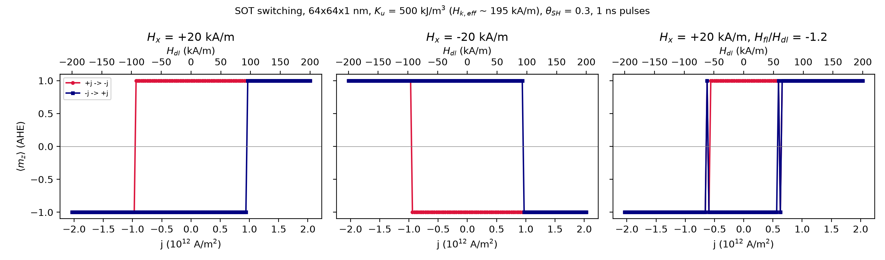

# SOT current-induced switching

Script: [`../sot_switching.py`](../sot_switching.py) · cmtj counterpart: `cims-hysteresis.py` · wall time JAX 548 s (Mac CPU) / 251 s (GB10), numba 3093 s

The device is a 64×64×1 nm PMA element (Ku = 500 kJ/m³, H_k,eff ≈ 195 kA/m, α = 0.1) on a heavy metal. Current along x gives a damping-like SOT with p = y; the current density is converted with a spin Hall angle θ_SH = 0.3. Each loop point is:
1. a 1 ns current pulse (RK45);
2. relaxation with the current off;
3. read-out of ⟨m_z⟩, the anomalous Hall signal.

The sweep goes 0 → +max, then +max → −max → +max, with cmtj's step of 2·max/130 (261 points per loop).

| case | switching H_dl | switching j |
| --- | --- | --- |
| H_x = +20 kA/m | −95 / +95 kA/m | ∓0.97×10¹² A/m² |
| H_x = −20 kA/m | +95 / −95 kA/m (polarity reversed) | ±0.97×10¹² A/m² |
| H_x = +20 kA/m, H_fl/H_dl = −1.2 | ±58–65 kA/m | ±0.60–0.66×10¹² A/m² |

As expected for damping-like SOT, the switching polarity is set by the sign of the in-plane bias field. A field-like torque lowers the threshold. With it, the dense sweep shows m_z flipping back and forth on successive pulses between 0.60 and 0.66 × 10¹² A/m², before switching settles. The pulse leaves the element close to the boundary between the two final states.
