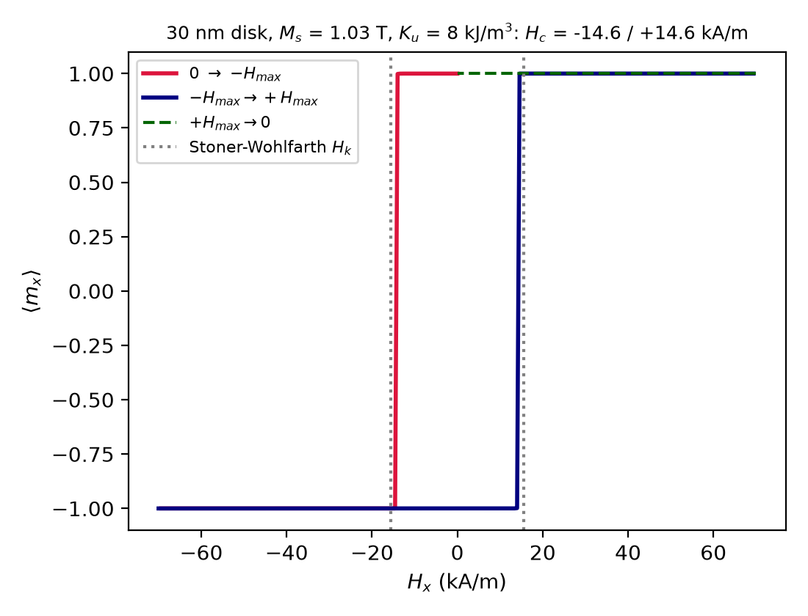

# Field-driven hysteresis loop

Script: [`../switching_hysteresis.py`](../switching_hysteresis.py) · cmtj counterpart: `switching-hysteresis.py` · wall time 22 s (numba, 1 thread)

The element is cmtj's free layer resolved on a mesh: a 30 nm disk, 2.1 nm thick, on 3 nm cells (Ms = 1.03 T, Ku = 8 kJ/m³ along x), with full demag and exchange. The field along the easy axis is swept 0 → −70 → +70 → 0 kA/m in 480 points with a 100 A/m transverse bias. Each point is relaxed with the energy minimiser, starting from the previous state, so the metastable branch is kept.

Results:
- The loop is square, with coercive fields of ±14.6 kA/m.
- The Stoner-Wohlfarth field H_k = 2Ku/(μ0 Ms) = 15.5 kA/m is marked. The disk reverses about 6 % below it: a 30 nm disk is close to, but not exactly, a coherently rotating macrospin.

Numerical note: `relax` is called with `tol=1e-6`. With the default RK45 tolerance of 1e-4, the step-size error keeps the residual torque near tol/(γ dt) ≈ 650 A/m. That is above the convergence criterion here, so every point runs to `max_steps`.
