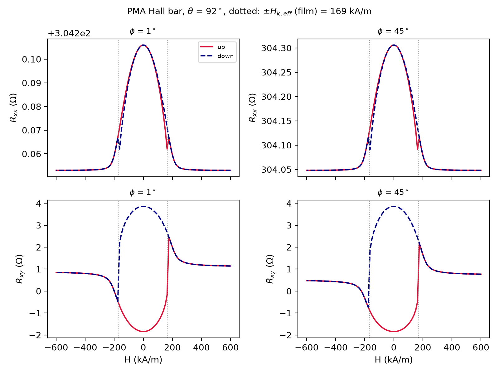

# Rxx / Rxy magnetoresistance sweeps

Script: [`../magnetoresistance.py`](../magnetoresistance.py) · cmtj counterpart: `harmonic-hall.py` · wall time 89 s (numba, 1 thread)

The material and resistance model are cmtj's Ta/CoFeB Hall bar: Ms = 0.525 T, Ku = 154 kJ/m³, and Kim's formula with AMR = −0.053 Ω, SMR = −0.464 Ω, AHE = −5.71 Ω. Here it is a 128×128×1.45 nm element on 4 nm cells. The field is tilted 2° out of the plane (θ = 92°) at φ = 1° or 45°. It is swept −600 → +600 → −600 kA/m, and every point is relaxed from the previous state. The resistances use cell averages of m_x², m_y², m_x m_y and m_z.

Results:
- **R_xy (AHE):** a hysteresis loop between m_z = ±1, R_xy = R_y0 ± AHE/2 (3.86 / −1.85 Ω), that switches close to the thin-film H_k,eff = 2Ku/(μ0 Ms) − Ms = 169 kA/m. At high field it settles to the small m_z left by the 2° tilt. At φ = 45° the planar Hall term (SMR + AMR)(w/l) m_x m_y shifts the saturated values.
- **R_xx (AMR + SMR):** highest when m is out of plane and lowest when m is saturated in plane. The kinks at ±H_k,eff are the switching events.

Numerical note: `relax` uses `tol=1e-6` (see [`switching_hysteresis`](../../switching/results/switching_hysteresis.md)).
