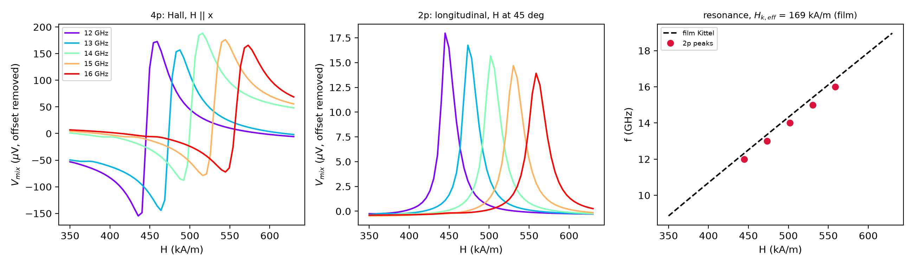

# Spin-diode (VSD) field scans

Script: [`../spin_diode.py`](../spin_diode.py) · cmtj counterpart: `vsd-basic-field-scan.py` · wall time 1409 s (JAX, float32, NVIDIA GB10)

The device is the Ta/CoFeB element of [`magnetoresistance`](magnetoresistance.md): 128×128×1.45 nm on 4 nm cells, Ms = 0.525 T, Ku = 154 kJ/m³, α = 0.03. An RF current I(t) = I_rf sin(2πft) drives the magnetisation through its Oersted field (amplitude 5 kA/m). The resistance R(t) comes from Kim's formula. The DC mixing voltage V_mix = ⟨I R⟩ is averaged over the second half of each 20 ns run (RK4, dt = 0.1 ps). There are 60 fields from 350 to 630 kA/m (θ = 91°) × 5 frequencies from 12 to 16 GHz × 2 geometries, so 600 runs, integrated as one `jax.vmap` batch. The observer keeps only ⟨m_x²⟩, ⟨m_y²⟩, ⟨m_x m_y⟩ and ⟨m_z⟩, so no full magnetisation history is stored.

Results:
- **4p (Hall, H ∥ x, I_rf = 0.75 mA):** dispersive (antisymmetric) lines, as in cmtj. The Hall voltage mixes the m_z oscillation with the in-phase current.
- **2p (longitudinal, H at 45°, I_rf = 0.4 mA):** symmetric Lorentzian lines from the planar m_x m_y term. Their peaks give the resonance field.
- **Resonance:** the 2p peaks follow the thin-film Kittel law f = γ₀/2π √(H(H − H_k,eff)) with H_k,eff = 169 kA/m. They sit about 10 kA/m higher in field, which is about the in-plane shape anisotropy (N_x Ms) of the finite 128 nm element.

Speed: 1.2 × 10⁸ RK4 steps on a 32×32 mesh in 1409 s, i.e. ~12 µs per step per simulation on the GPU in float32.
